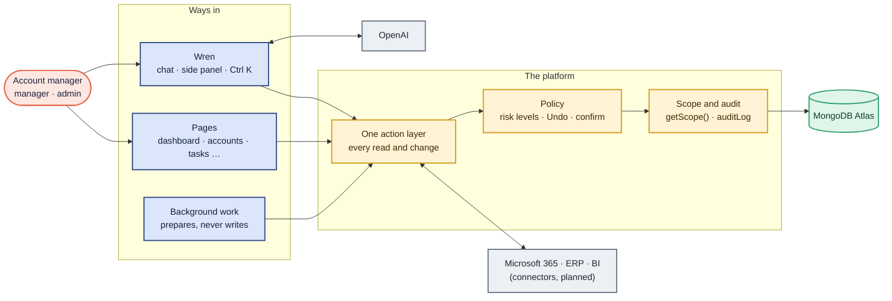

# Ambient CRM

**The CRM you can just ask.** Ambient is a multi-tenant CRM for B2B account
managers with an AI assistant, **Wren**, at its core: anything you can do in
Ambient, you can ask Wren to do, with the same rights and the same rules.
Small changes to your own work happen at once and can be undone; anything that
touches other people, many records or the outside world waits for your yes.
The pages stay as a dependable visual workspace, but nobody has to go page by
page filling in forms.

[](https://github.com/sonishivam1/ambient-crm/actions/workflows/ci.yml)

It also fills itself in: customer email and meetings are captured and filed on
each account's timeline (planned), so reps spend their time with customers
rather than logging activity.

## How it works



**The platform is the actions and the policy, not the chat.** Pages, Wren,
background jobs and connectors all call the same typed actions, so Wren can
never do more than the user could from the form, and a new feature works in
chat the day it ships.

## The rules that keep it safe

1. **The model never reaches the database.** It sees only facts built from
   what the signed-in user may see, with real ids replaced by short handles.
2. **Wren can do what the user can, and nothing more.** Every tool is an
   action with the form's own permission check, validation and audit row.
3. **Nothing changes unless you asked.** Risk levels are set by code: reads
   run; your own small changes run with Undo; changes to others' work, batches
   and anything sent outside Ambient wait for a confirm bound to that exact
   change. Text from customers or connectors can never trigger a change; users,
   roles and settings are never changed by AI.
4. **Facts on screen come from records.** Tasks, visits, figures and charts
   are rendered from the database; the model's text only interprets them, and
   every claim is checked against the records it cites.
5. **Every call and change is gated, budgeted, logged and measured.** AI is
   off by default per organisation, with token budgets, rate limits, usage
   logs without content, and an evaluation set as the release gate.

Full design: [AI layer](docs/architecture/ai.md) (built) and the
[AI-first design](docs/architecture/ai-first.md)
([ADR 0008](docs/architecture/decisions/0008-ai-first.md)).

## Where it is

**Built, on fictional demo data:**

| Area | What you can do |
| --- | --- |
| Dashboard | Today's tasks, the week's visits, KPIs, at-risk accounts, notifications, the morning brief headline |
| Accounts | Customer groups, bill-tos and sold-tos with filters, search and drill-down; a profile per account and per group |
| Tasks | Today and all views; create, edit, assign (managers), complete, cancel |
| Call cycle | The next six weeks as a list or week grid; plan, reschedule, cancel; complete with a post-visit scorecard |
| Contacts | A directory with search and role filters; add, edit, deactivate |
| Contracts | Renewal bands (ended, 30, 60, 90 days, later) with search; a card on each profile |
| Notifications | Your history by day; mark read or all read |
| Wren | Account summaries, the morning brief, chat over your tasks, visits, renewals, contacts and accounts, proposed tasks, visits and notes, follow-ups after a visit report, the side panel on every page, 👍 / 👎 feedback, the admin AI usage report |
| Quality | Unit and integration tests on throwaway databases, Playwright end-to-end tests for every role and phone width, an AI evaluation harness with a baseline gate, CI on every push |

Every page respects the tenant, the user's role visibility and the division
lens, and shows dates on the tenant's calendar. Wren's answers need the OpenAI
key; until then it says "AI isn't set up yet" and everything else works.

**Next ([AI-first plan](docs/plans/ai-first-plan.md), agreed and frozen):**
key day (the real model, the model choice, the baseline), then:

| Phase | What it adds |
| --- | --- |
| A · Action layer | Every read and change becomes a shared, idempotent, version-checked action; Wren's tools come from it; risk levels; Undo |
| B · Wren does the work | Tasks, visits and reports, notes and contacts from chat; plans you can stop; questions asked back as buttons |
| C · Chat-first | Tables, calendars, charts and prefilled forms in the chat; a Wren home; memory only when you ask |
| D · Skills | "Prepare for my visit", "renewal check", "weekly review"; admins write their own |
| E · Connectors | Microsoft 365 mail and calendar, the ERP on demand, BI, approved MCP servers |
| F · Background work | Scheduled runs that prepare things for your Wren inbox and never write |
| G · Trust and admin | AI policy controls, kill switches, the AI activity log, the release gate |

Alongside: the admin and manager pages, sign-in and hosting, the warehouse
sync and passive capture, in the [completion plan](docs/plans/completion-plan.md)
and the [roadmap](docs/product/roadmap.md).

## Stack

| Layer | Choice |
| --- | --- |
| Web | Next.js 16 (App Router, Cache Components, Turbopack), React 19, TypeScript strict |
| UI | Tailwind CSS 4 design tokens (navy and coral, light and dark), Radix primitives, lucide icons, sonner, cmdk |
| AI | OpenAI through the Vercel AI SDK, on one engine in `apps/web/lib/ai` ([ADR 0006](docs/architecture/decisions/0006-ai-provider.md)) |
| Data | MongoDB Atlas (official driver) with Zod schemas as the single source of truth |
| Quality | Vitest (unit, integration, AI evaluation), Playwright, GitHub Actions |
| Workspace | pnpm workspaces: `apps/web`, `packages/db`, `packages/logger` |
| Runtime | Node.js 24 (`.node-version`) |

## Getting started

Prerequisites: Node.js 24, pnpm 10 and a MongoDB Atlas cluster. Full steps
and troubleshooting: [getting started](docs/engineering/getting-started.md).

```bash
pnpm install
cp .env.example apps/web/.env.local
cp .env.example packages/db/.env
# put your Atlas mongodb+srv:// URI in both files (gitignored; never commit it)
pnpm --filter @ambient/db seed --allow-remote   # fictional demo data
pnpm dev                                        # http://localhost:3000
```

For Wren's answers, add `OPENAI_API_KEY` (and the model settings) to
`apps/web/.env.local`, server-side only: see
[configuration](docs/technical/configuration.md). Without it, every AI screen
says "AI isn't set up yet".

| Command | What it does |
| --- | --- |
| `pnpm lint` / `pnpm typecheck` | ESLint; route types and `tsc` for every package |
| `pnpm test` | Web unit and integration tests (integration in throwaway `ambient_test_*` databases) |
| `pnpm test:e2e` | Playwright against the production build, with its own seeded throwaway database |
| `pnpm ai:eval` / `pnpm ai:eval:compare` | The AI evaluation set against the real model, and the gate against the baseline |
| `pnpm build` | Production build (needs no database) |
| `pnpm db:inspect` | Read-only: what the database holds |

CI runs lint, typecheck, unit tests and the build, the integration suite and
the end-to-end tests on every push and pull request, against a throwaway
MongoDB (Atlas Local). It never touches the Atlas cluster and never calls
OpenAI.

### Seeding Atlas

```bash
pnpm db:inspect                                        # read-only: what the database holds
pnpm --filter @ambient/db seed --allow-remote          # seed an empty remote database
pnpm --filter @ambient/db seed --allow-remote --reset  # wipe and reseed a remote database
```

Seeding drops every collection in `MONGODB_DB` first. Against anything but
localhost it refuses without `--allow-remote`, and refuses to wipe a database
that already holds data without `--reset`. Allow your IP in Atlas → Network
Access first. Docker is optional: `pnpm db:up` starts a local MongoDB for
offline work.

### Demo tenants and users

Sign-in is a development stand-in: the gear icon in the top bar switches
between the seeded users. It only works with `AMBIENT_DEV_AUTH=1` outside
production (and in the end-to-end tests' production build, only against an
`ambient_test_*` database); real sign-in (Microsoft Entra ID, proposed in
[ADR 0005](docs/architecture/decisions/0005-hosting-and-sign-in.md)) replaces
it before any deployment.

| Tenant | Time zone and divisions | Users (role) |
| --- | --- | --- |
| Northwind | Australia/Sydney; wholesale, uniforms, ICW, other | Priya Nair (user), Liam Carter (manager), Grace Whitfield (senior manager), Noah Bennett (lead), Sam Patel (admin), Alex Morgan (super admin) |
| Harbor & Finch | Pacific/Auckland; trade, institutional | Zara Ahmed (user), Owen Price (manager), Rita Lopez (super admin) |

The two tenants deliberately share some account codes and a contact's email,
to prove nothing leaks between them. Northwind has AI turned on; Harbor &
Finch keeps the default (off).

## Layout

```
apps/web
  app/(app)/            every signed-in route; layout.tsx is the shell
  app/actions/          server actions (each one checks scope and writes an audit row)
  app/api/v1/           versioned HTTP routes (defineRoute), including Wren's chat stream
  components/<area>/    dialogs and controls per area (tasks, contacts, visits, …)
  components/ai/        Wren: summary, brief, chat, cards, proposals, feedback
  components/shell/     sidebar, top bar, Ctrl K palette, Wren side panel
  lib/ai/               the AI engine: gates, facts, prompts, tools, chat, proposals, evaluation
  lib/data/             server-only read models, always through getScope()
  lib/writes/           write rules shared by the forms and Wren's proposals
  lib/auth/             session, roles, account visibility
  lib/*.ts              pure rules shared by server and client, with unit tests
  tests/                integration suites, the test-only AI stand-in
  e2e/                  Playwright journeys per area and role
  evals/                AI evaluation cases, the harness and the baseline gate
packages/db             Zod models, indexes, the fictional demo data, seed and inspect scripts
packages/logger         structured, redacted logging (pino)
docs/                   product, architecture and decisions, design, engineering, plans
.github/workflows/      CI
```

Phase A adds `apps/web/lib/actions/`: the action registry, the policy and Undo.

## Core rules

- **Tenancy.** Every document carries `tenantId` and every query gets it from
  `getScope()` ([ADR 0004](docs/architecture/decisions/0004-multi-tenancy.md)).
- **Visibility.** User: own book. Manager: plus direct reports. Senior
  manager: the whole reporting tree. Lead and super admin: everything. Admin is
  a separate ladder and grants no account visibility on its own.
- **Audit.** Every write records an `auditLog` row in the same transaction,
  with before and after state but never note or email bodies.
- **Ownership classes.** Mirror data (reps, groups, accounts, contracts) comes
  from the customer's ERP or warehouse; rollups are dated snapshots; app-native
  data is soft-deleted, never hard-deleted.
- **Division lens and time zone.** Each tenant defines its own divisions and
  lenses; "today", "overdue" and every date use the tenant's time zone.
- **AI.** One engine; OpenAI only, key server-side; facts only from scoped
  read models; verify, then show; no AI-only write path. Prompts are versioned
  and every prompt or model change passes the evaluation gate.

## Documentation

- [docs/](docs/README.md): product, architecture (with decision records),
  design system, engineering, technical and marketing.
- [CLAUDE.md](CLAUDE.md): read first if you're contributing (people or coding
  agents): the rules every change follows and the definition of done.
- History: the [build log](docs/engineering/build-log.md), the
  [plans](docs/plans/) behind each step, and the [changelog](CHANGELOG.md).
