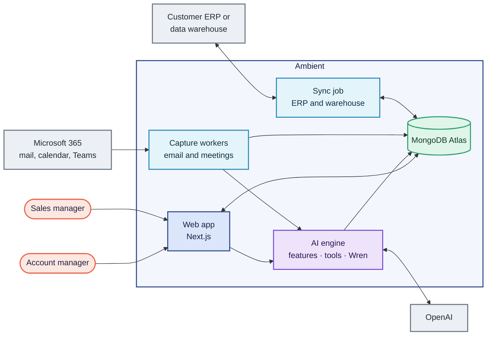

# Ambient CRM documentation

Ambient is a CRM for B2B account managers that fills itself in. It captures
customer email and meetings automatically, files them on each account's
timeline, and puts an AI assistant (Wren) on top, so reps spend their time with
customers instead of logging activity.

Every document marks what is **Built** today and what is **Planned**. When the
code and a document disagree, the code is right and the document needs fixing.

## Map

| Folder | Read it when you want to know… | Documents |
| --- | --- | --- |
| [product/](product/) | what we are building, for whom, and in what order | [Vision](product/vision.md) · [Personas](product/personas.md) · [Features](product/features.md) · [Roadmap](product/roadmap.md) · [Glossary](product/glossary.md) |
| [architecture/](architecture/) | how the system fits together and why | [Overview](architecture/overview.md) · [Data model](architecture/data-model.md) · [Security and access](architecture/security.md) · [Integrations](architecture/integrations.md) · [AI layer](architecture/ai.md) · [AI prompts](architecture/ai-prompts.md) · [Decisions](architecture/decisions/) |
| [design/](design/) | how the product looks and behaves | [Design system](design/design-system.md) |
| [engineering/](engineering/) | how to work in the codebase | [Getting started](engineering/getting-started.md) · [Conventions](engineering/conventions.md) · [Testing](engineering/testing.md) · [Git workflow](engineering/git-workflow.md) · [Build log](engineering/build-log.md) |
| [plans/](plans/) | what each step set out to build, and what was built | [Plans](plans/README.md) |
| [technical/](technical/) | how it is configured, deployed and run | [Configuration](technical/configuration.md) · [Server API](technical/server-api.md) · [Deployment](technical/deployment.md) · [Operations](technical/operations.md) |
| [marketing/](marketing/) | how we describe and sell it | [Positioning](marketing/positioning.md) · [Go to market](marketing/go-to-market.md) |

## The system on one page

The full application, layer by layer, is in the
[architecture overview](architecture/overview.md#the-whole-application).

## Keeping docs current

- Change the doc in the same pull request as the code it describes.
- New architectural choices get a decision record in
  [architecture/decisions/](architecture/decisions/).
- Diagrams are Mermaid inside Markdown, so they diff and review like code.
