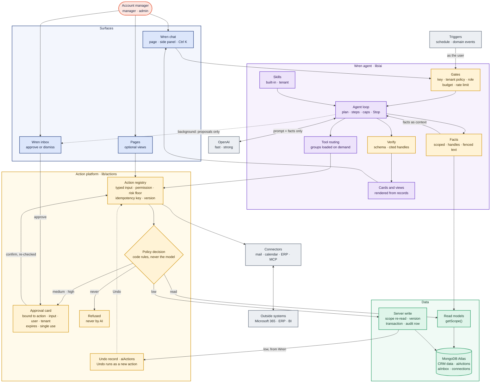
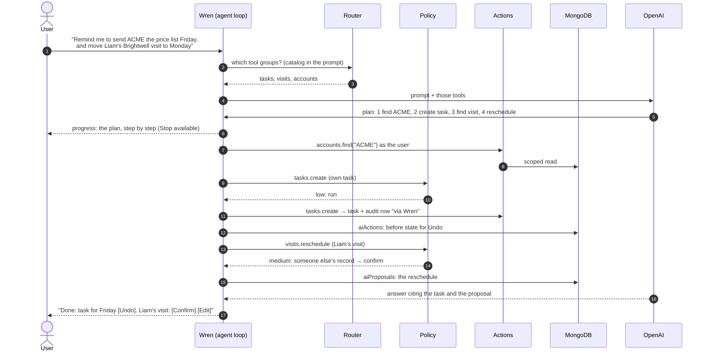

# AI-first design: Wren can do what the user can

**Status:** Agreed and frozen (23 Oct 2026), with
[ADR 0008](decisions/0008-ai-first.md). Built in phases A to G of the
[AI-first plan](../plans/ai-first-plan.md). Until a phase is built, the
[AI layer](ai.md) describes what runs today; this page describes what replaces
or extends it, and where they differ this page wins once its phase ships.

The aim: a person can do **everything** in Ambient by asking. Wren finds,
explains, changes and prepares across every area of the CRM and the systems
connected to it. The pages stay as an optional view, but nobody has to go page
by page and fill in forms. Every rule the forms enforce still applies, because
Wren uses the forms' own code.

**The platform is the actions and the policy, not the chat.** Pages, Wren,
background jobs, connectors and, later, Ambient's own API and MCP server are
all clients of the same action registry and the same policy. Wren is the
primary way in; the pages are the dependable visual workspace.

## Five guarantees

1. **The model never reaches the database.** Unchanged: it sees only facts our
   code built from scoped read models (`getScope()`).
2. **Wren can do what the user can, and nothing more.** Every tool is an
   action from the one action registry, run as the signed-in user, with the
   same permission check, validation and audit row as the form. There is no
   AI-only write path.
3. **Nothing changes unless the user asked for it.** Low-risk changes run and
   can be undone; anything touching others, many records or the outside world
   waits for the user's confirm; text from customers or connectors can never
   cause a change on its own; background work never writes.
4. **Facts on screen come from our records.** Unchanged, and extended to
   views: tables, calendars and charts in the chat are rendered from records
   and code-computed figures, never from model text.
5. **Every call and every change is gated, budgeted, logged and measurable.**
   Unchanged for calls; every change Wren makes is audited "via Wren", listed
   in the user's Wren activity, and undoable while allowed.

## Architecture



Colour key: coral = people · navy = surfaces · violet = the agent · amber =
safety · green = data · grey = external. **The model chooses intent; the
application chooses authority:** Wren plans, explains and asks for actions;
code decides access, risk, confirmation, transactions and audit. The whole
application, with what is built today, is on the
[architecture overview](overview.md#the-whole-application).

## Building blocks

| Block | What it is | Adding one means |
| --- | --- | --- |
| **Action** | One thing Ambient can do: a read or a change, with typed input, a permission check, a base risk level, a preview sentence and an audit row. Forms, pages, Wren and jobs all call actions | One `defineAction` |
| **Tool** | An action as Wren sees it: generated from the action (name, description, input schema). Hand-written tools go away | Nothing: it comes with the action |
| **Tool group** | The tools of one area (tasks, visits, accounts, contacts, contracts, notifications, search, a connector), loaded only when a request needs them | A group name on the action |
| **Policy** | Code that turns an action, its input and the turn's context into run, run with Undo, confirm, or refuse | Rules in `lib/actions/policy.ts` |
| **Proposal** | A change waiting for the user's confirm (the existing `aiProposals`), now for any medium or high action, one or several in a review card | Nothing: generic |
| **Undo record** | The state before a change Wren ran, so Undo can restore it (`aiActions`) | Nothing: generic, an action can opt out |
| **View** | A way to show records in the chat: table, week calendar, KPI tiles, chart, record detail, prefilled form. Rendered from records by code | One `defineView` |
| **Skill** | A saved routine for a job ("prepare for my visit", "renewal check"): instructions, the tool groups it may use, its inputs and evaluation cases. Built-in in code; tenant skills written by admins | One `defineSkill`, or a settings entry |
| **Connector** | An outside system: how to connect (per tenant or per user), its actions and their risk, a health check. Its content is always untrusted | One `defineConnector` |
| **Trigger** | Runs a skill on a schedule or a domain event, as the user, in the background; results and proposals go to the inbox | One registration |
| **Inbox item** | What background work found or prepared, waiting for the user (`aiInbox`) | Nothing: generic |
| **Memory** | A preference the user asked Wren to remember ("visits on Tuesdays"), visible and deletable; never inferred silently (`aiMemories`) | Nothing: generic |

### The contracts (sketch)

```ts
// An action: the same code for the form, the page, Wren and jobs.
export const completeTask = defineAction({
  id: "tasks.complete",
  group: "tasks",
  kind: "write",                               // "read" | "write"
  risk: "low",                                 // the floor; policy may raise it
  description: "Mark one of the user's tasks complete.",
  input: z.object({ taskId: z.string() }),
  preview: (input, ctx) => `Mark “${ctx.record.title}” complete`,
  allowed: (scope) => scope.user.capabilities.visibility !== "none",
  // Every call carries an idempotency key; a write to an existing record
  // carries the version it was previewed against.
  run: async (scope, input, { tx, idempotencyKey, expectedVersion }) => {
    // re-reads the task in scope, refuses a stale version, writes the change
    // and the audit row in one transaction
  },
  undo: "restore",                             // restore the saved state, if unchanged since
});

// A view: the model picks the kind and the handles; code renders the records.
export const recordTable = defineView({
  id: "table",
  input: z.object({ handles: z.array(z.string()).max(50), columns: z.array(ColumnKey) }),
});

// A skill: instructions plus the tools it may use; it runs as the user.
export const visitPrep = defineSkill({
  id: "visit-prep",
  name: "Prepare for a visit",
  groups: ["accounts", "visits", "tasks", "contacts", "contracts"],
  input: z.object({ visitId: z.string() }),
  instructions: visitPrepPrompt,               // versioned like every prompt
});

// A connector: how to connect and what it adds.
export const microsoft365 = defineConnector({
  id: "m365",
  auth: { kind: "oauth", per: "user", scopes: ["Mail.ReadWrite", "Mail.Send", "Calendars.ReadWrite"] },
  actions: [searchMail, draftReply, sendMail, listEvents, createEvent],
  health: pingGraph,
});
```

## Risk levels

The policy sets the level from code rules; the model's opinion is never
asked.

| Level | What happens | Examples (built-in floor) |
| --- | --- | --- |
| **read** | Runs; results as cards or a view | Every read action |
| **low** | Runs at once; the result card has **Undo** (24 hours, while the record is unchanged) | Your own task: create, edit, complete; log a note or call on an account you can see; mark notifications read; plan your own visit; add a contact; save a memory; draft (not send) a reply |
| **medium** | A confirm card: Confirm, Edit, Dismiss. Several in one turn come as one review card (confirm all or each) | Assign or reassign a task to someone else; reschedule or cancel a visit; edit or deactivate a shared contact; anything on another person's records; a calendar event with attendees |
| **high** | A full preview of exactly what will happen and an explicit Confirm, one at a time | More than 10 records in one request; contract create or edit; sending an email; anything a connector sends outside Ambient |
| **never by AI** | Not offered as a tool | Users, roles, access, view as, organisation settings, the AI policy, connector set-up, deleting data |

Rules that **raise** a level (they never lower one):

1. The action touches a record owned by someone else: at least medium.
2. **Batches:** more than 3 records changed in one request: at least medium,
   as one review card; more than 10: high. A clean-up is always proposed,
   never run on its own.
3. **Untrusted text:** the turn has read customer- or connector-written text
   (notes, email, documents, connector results): every write at least medium.
   Such text may inform a suggestion; it never triggers a write by itself.
4. **Wren-written text:** a note, interaction, visit report or message whose
   body Wren composed (rather than the user's own words) is at least medium,
   so the user approves the exact text. Short titles Wren fills in from the
   request don't count.
5. The tenant raised the action (or its group) in its AI policy.
6. The user chose "always ask me": every write at least medium.
7. A background run: every write becomes an inbox proposal.

## One request, end to end



## Confirmations

- **A confirm is bound to one exact change:** the proposal id, the action,
  a hash of the validated input, the user and the tenant. Only the card's
  Confirm (or Edit, then save) carries it out.
- **Typing "yes" never confirms anything.** A reply in the chat can ask Wren
  to prepare a change; it can't approve one.
- **Short-lived:** a confirm card from chat expires after 24 hours; an inbox
  proposal from background work after 7 days.
- **Checked again at confirm time:** the action re-validates the input, the
  user's rights and the record's version. If the record changed since the
  preview, Wren shows a fresh preview instead of applying the old one.

## Idempotency and concurrency

- Every action call carries an **idempotency key** (the proposal id, or a key
  per tool call): a retried request, a double click or a resent stream never
  writes twice.
- A write to an existing record carries the **version** it was previewed or
  read against; a stale version is refused, so Wren never overwrites a change
  someone made in between. Undo uses the same check.

## Audit and tracing

Every change, from any client, writes the audit row it writes today, plus:
`via` (`form`, `wren` or `job`), the request id, the conversation or proposal
id, and the outcome (done, refused, undone). Changes Wren made also record the
prompt version, policy version and model in `aiActions`. Content stays out of
logs, as today.

## Tool routing

- Every action belongs to a **group**. The prompt carries a short catalog
  (group names, one line each) and a `use_tools(groups)` tool; Wren loads the
  groups a request needs, at most 20 tools at once. A request about tasks
  never sees the contract tools.
- A small core is always loaded: find an account, find a person, search, and
  `use_tools`.
- Tool names, descriptions and schemas come from the actions, so the catalog
  stays in step with the app. Each description is checked word for word
  against [AI prompts](ai-prompts.md), like today.

## Agent loop

- **One agent:** a single Wren loop with tool routing; specialist agents
  only if routing or ownership ever becomes genuinely unclear. The loop stays
  on the AI SDK ([ADR 0006](decisions/0006-ai-provider.md)); an agent
  framework (such as OpenAI's Agents SDK) is an option to revisit later for
  handoffs or tracing, not a dependency now.
- **Bounded:** at most 8 tool calls and 60 seconds per request by default
  (tenant setting, never above 20 and 180 seconds), and one plan per request.
- **Visible:** a multi-step request shows its plan first, then each step as it
  runs; **Stop** ends it at once (finished low-risk steps keep their Undo).
- **Tiers:** a single-step request runs on the fast tier; a plan with more
  than two steps, and every skill, on the strong tier when the evaluation set
  shows the fast tier falls short (decided on key day).
- **Ask back with buttons:** an ambiguous name, a missing date or a choice
  between options comes back as buttons (the matching accounts, "this Friday"
  or "next Friday"), so the user taps instead of typing.
- **Never claims success:** every result comes from the action
  (`ok: true` with records, or `ok: false` with a reason); the answer cites
  them, and verification drops anything else, as today.

## Undo

- Every write Wren runs saves an `aiActions` row: who, the conversation, the
  action and its input, the records it touched and their state before.
- **Undo** (on the result card, and in the user's Wren activity) restores that
  state through an undo action with the same scope check and audit row, for 24
  hours and only while the record is unchanged since; otherwise it says why it
  can't.
- Creating something is undone by cancelling or deleting it softly; an action
  with no safe inverse (a sent email) is never *low*.

## Views

Wren chooses a view and the records to show; code renders them from the
database, so figures are never model text.

| View | Shows |
| --- | --- |
| Table | Up to 50 records of one kind, chosen columns, sortable, each row opening its card |
| Week calendar | Visits and tasks over one or two weeks |
| KPI tiles | Figures computed by code (open tasks, overdue, renewals in 30 days, sales against target) |
| Chart | A series computed by code (visits per week, sales by month), never numbers from the model |
| Record detail | One account, contact, contract, task or visit |
| Prefilled form | The normal form, filled in, for when the user would rather check every field |

Each view has "Open the full page" for the same records.

## Context and memory

- Wren knows the page the user is on and the record on it (the side panel does
  this today), and the last turns of the conversation.
- **Memory is explicit:** "remember that I visit Castleford on Tuesdays" saves
  a memory the user can see and delete in their Wren settings. Nothing is
  remembered silently, memories are the user's only, and they're facts in the
  prompt like any other (fenced, capped).

## Skills

- **Built-in skills** ship as code with their own evaluation cases: prepare
  for a visit, renewal check, weekly review of my book, follow up after a
  meeting, account plan, clean up my tasks.
- **Tenant skills:** an admin writes the instructions, picks the tool groups
  it may use and the roles who see it, and tries it on demo data before
  enabling it. Versions are kept; every run logs the version.
- A skill runs as the user inside the same policy, so it can never do more
  than the user can.
- Users start a skill by asking ("prepare me for tomorrow's Castleford visit")
  or from a suggestion chip.

## Connectors

- `defineConnector` declares the connection (per tenant or per user, OAuth),
  the actions it adds, their risk levels and a health check. An admin turns a
  connector on for the tenant; each user consents for their own mailbox or
  calendar.
- **Tokens** are stored encrypted in `connections` (envelope encryption with
  the host's key service), never logged, never sent to the model or the
  browser.
- **Content is untrusted:** mail, events and documents arrive fenced, redacted
  (card, bank, tax and identity numbers), and trigger the untrusted-text rule.
  The participant fence applies: Wren reads only mail the user was on.
- **Planned connectors:** Microsoft 365 (mail and calendar: search, read,
  draft, send, events), the ERP or warehouse (order status, stock, on demand,
  alongside the nightly sync), BI (report links).
- **Sending is high:** one message, a preview of the exact text and
  recipients, from the user's own mailbox, on an explicit Send. Never bulk,
  never from a background run; a tenant can turn sending off.
- **MCP servers (last):** an admin can add an approved remote MCP server. Each
  tool is approved one by one, starts at high, and its description is pinned:
  a changed description disables the tool until re-approved.

## Background work and the Wren inbox

- **Triggers** run a skill as the user on a schedule or an event (7am brief,
  renewal check when a contract enters 30 days, follow-ups after a visit
  report, a weekly overdue sweep). Each user opts in per trigger.
- Background runs **read and prepare only**: every change becomes a proposal
  in the user's **Wren inbox**, with what was found and why. The user approves
  or dismisses, one by one or together.
- They have their own share of the tenant's token budget and a per-user daily
  cap; a failed run is logged and alerts the operators, never retried silently
  into extra cost.
- Needs the job runner and a way to run as a user without a browser session
  (completion plan 2.3 and 2.2).

## Admin controls

- **AI policy** (organisation settings): on or off, roles, features, monthly
  budget (today), plus: which tool groups each role may use, any raised risk
  levels, "cautious mode" (every write confirmed), whether sending is allowed,
  which connectors and skills are on, and the agent loop's caps.
- **Kill switches:** AI for the tenant, a tool group, a connector, a skill,
  background runs. Each takes effect on the next request.
- **Wren activity:** each user sees everything Wren did for them (with Undo
  while allowed); admins see the tenant's AI actions as metadata (who, which
  action, when, risk, undone or not), never the content.

## Security guarantees

The table in the [AI layer](ai.md#security-guarantees) still holds; these are
added or changed.

| Threat | Control |
| --- | --- |
| Wren changes something the user couldn't | Tools are actions; actions run the same permission check and scope re-read as the form; guard tests fail any write outside the registry |
| A planted instruction in a note, email or connector result makes Wren change data | The untrusted-text rule: after reading such text, every write needs the user's confirm; content stays fenced; evaluation cases try exactly this |
| A small change turns out wrong | Undo for 24 hours while unchanged; every AI change audited "via Wren" and listed in the user's activity |
| A runaway loop or a bulk change | Step and time caps, Stop, the batch rule (more than 3 records is one review card, more than 10 is high), budgets and rate limits |
| A confirm is replayed, reused or applied to something else | Bound to the proposal id, action, input hash, user and tenant; single use; expires; typed "yes" never confirms |
| A retry writes twice, or Wren overwrites someone's edit | Idempotency key on every call; version check on every write and Undo |
| Wren puts words in the user's mouth | Wren-written note, report or message text is always previewed and approved |
| Wren emails a customer by mistake | Sending is high: exact preview, explicit Send, one at a time, user's own mailbox, never in the background, tenant can switch it off |
| A connector token leaks | Encrypted at rest, server-only, never logged or sent to the model; per-user consent; revocable; the connector's kill switch |
| A malicious MCP server | Admin-approved servers only; tools approved one by one, high by default; pinned descriptions; its output untrusted |
| A tenant skill misbehaves | Runs as the user inside the policy; tool groups limited; versioned, tried before enabling; kill switch |
| Background work does something nobody saw | Background runs never write; everything waits in the inbox |

## Evaluation

- Every action group gets cases: the right action with the right input,
  refusals the user couldn't do, ambiguous requests asked back, multi-step
  plans, and **injection cases** where planted text tries to cause a write.
- Every built-in skill and connector gets its own cases; a tenant skill can be
  tried on demo data before it's enabled.
- The gate (`pnpm ai:eval:compare` against the baseline) runs on the real
  model before each release and on every prompt, tool-description or model
  change. CI keeps using the stand-in.

## Data model additions

| Collection | Holds | Kept |
| --- | --- | --- |
| `aiActions` | Each change Wren ran: user, conversation, action, input, records, state before, prompt and policy versions, model, outcome, undone at | 90 days (Undo for 24 hours) |
| `aiProposals` (existing) | Changes waiting for a confirm: now any medium or high action, alone or in a review set, bound to the action, the input hash, the user, the tenant and the record version | 24 hours from chat, 7 days from the inbox |
| `aiInbox` | Background results and their proposals, per user | 30 days |
| `aiMemories` | Preferences a user asked Wren to remember | Until the user deletes them |
| `aiSkills` | Tenant skills and their versions | Until deleted (soft) |
| `connections` | Connector connections per tenant or user, encrypted tokens, consent, health | Until disconnected |
| `auditLog` (existing) | Gains `via` (`form`, `wren`, `job`), the request id, the conversation or proposal id and the outcome | As today |

## Code layout (planned)

```
apps/web/lib/actions/
  define.ts         defineAction, the registry, formAction (forms call actions)
  policy.ts         risk levels and the rules that raise them
  undo.ts           aiActions: save state before, restore while unchanged
  tasks.ts, visits.ts, contacts.ts, interactions.ts, notifications.ts, …   actions per area
apps/web/lib/ai/
  tools/            generated from the registry; use_tools and the catalog
  agent.ts          the agent loop: plan, steps, caps, Stop
  views/            defineView and the view kinds
  skills/           defineSkill and the built-in skills
  connectors/       defineConnector, connections, Microsoft 365, ERP, MCP
  inbox.ts          aiInbox
  memory.ts         aiMemories
```

## Still deliberately not built

- AI changes to users, roles, access, settings or the AI policy.
- Hard deletes by the AI.
- Sending anything in bulk, or from a background run.
- Fine-tuned models; free or local models.
- Memory the user didn't ask for.
