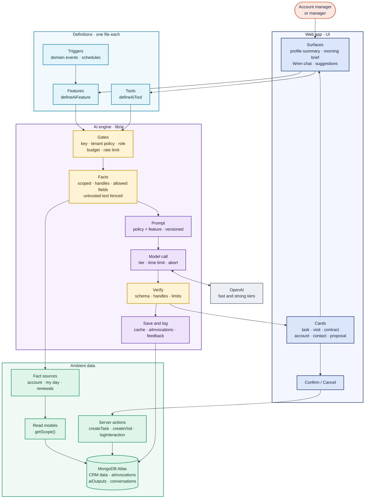
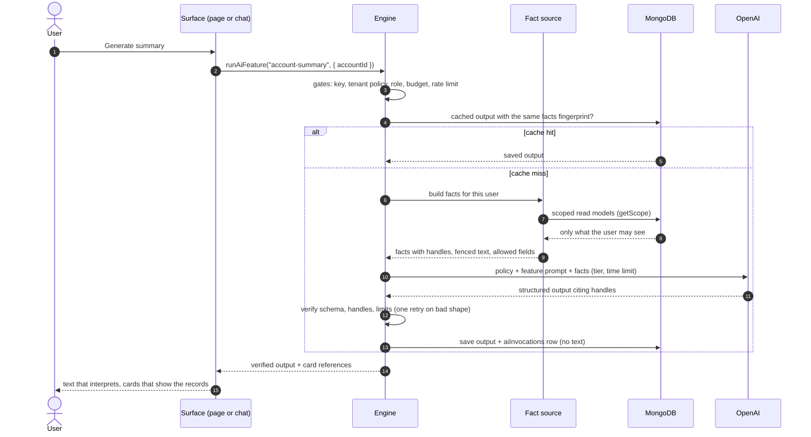
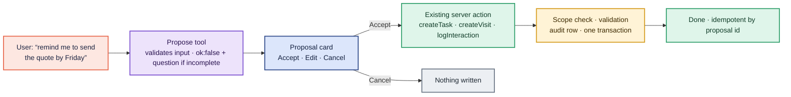
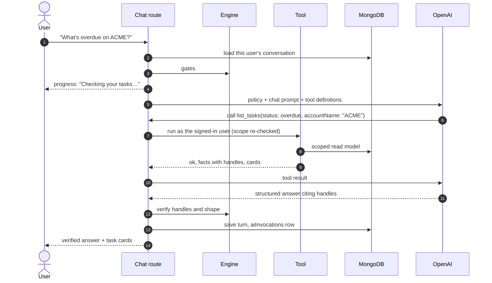

# AI layer

**Status:** designed; built step by step (see [Build order](#build-order)).
Provider: OpenAI through the Vercel AI SDK
([ADR 0006](decisions/0006-ai-provider.md)). Prompts: [AI prompts](ai-prompts.md).

Ambient's AI is a **platform inside the app**, not a set of hand-wired
features. Every AI capability is a small *definition* (a feature, a tool, a
fact source, a card, a trigger) and one **engine** runs every definition the
same way, inside the same safety layer. Adding a capability means adding a
file; no new capability can skip a safeguard, because none of them talks to the
model directly.

This page is the single source for the AI design and its rules. Other documents
link here rather than repeat it.

## Four guarantees

However many features we add, the engine enforces:

1. **The model never reaches the database.** It only sees facts our code built
   from scoped read models (`getScope()`): what the signed-in user may see,
   nothing else.
2. **Nothing changes without the user.** The model can only *propose*; the user
   confirms; the change runs through our existing server actions with their
   scope check and audit row.
3. **Facts on screen come from our records.** Tasks, visits, contracts and
   figures are shown as cards drawn from the database; the model's text only
   interprets them, and is checked before it is shown.
4. **Every call is gated, budgeted, logged and measurable.** Off by default per
   tenant; usage logged without content; quality measured with an evaluation set.

## Architecture



Colour key: coral = people · navy = UI · teal = definitions · violet = engine ·
amber = safety steps · green = Ambient data · grey = external.

## Building blocks

| Block | What it is | Adding one means |
| --- | --- | --- |
| **Feature** | A one-shot AI job (account summary, morning brief, follow-up suggestions) | One `defineAiFeature` file |
| **Tool** | Something chat (and later, jobs) can use: a *read* tool returns facts and cards; a *propose* tool returns a proposal | One `defineAiTool` file |
| **Fact source** | A shared builder of scoped facts ("account", "my day", "renewals") with handles and an allowed-field list; reused by features and tools | One file |
| **Card** | UI for one kind of record (task, visit, contract, account, contact, proposal), rendered from database records, never from model text | One component |
| **Proposal** | A change the AI suggests, mapped to an **existing** server action, confirmed by the user, idempotent by proposal id | One mapping |
| **Trigger** | Runs a feature on a domain event or schedule (visit completed, contract enters the 30-day band, 7am brief in the tenant's zone) | One registration |
| **Model tier** | `fast` or `strong`, mapped to `OPENAI_MODEL` and `OPENAI_MODEL_STRONG` | A setting |
| **Tenant AI policy** | In the tenant record: on/off, allowed roles, enabled features, monthly token budget | A field |
| **Evaluation cases** | Fictional inputs with expected results per feature, run by `pnpm ai:eval` | One file |
| **Feedback** | Thumbs up/down on every answer; poor answers become evaluation cases | Built in |

### The contracts (sketch)

```ts
// A feature: the engine does gates, facts, call, verify, save and log.
export default defineAiFeature({
  id: "account-summary",
  version: 1,
  roles: ["user", "manager", "senior", "lead"],
  tier: "fast",
  input: z.object({ accountId: z.string() }),
  facts: accountFacts,                    // fact source: scoped, with handles
  prompt: accountSummaryPrompt,           // versioned module (ai-prompts.md)
  output: AccountSummarySchema,           // strict structured output
  cache: { until: "facts-change" },
});

// A tool: the engine re-checks scope, enforces the result contract, times and logs it.
export default defineAiTool({
  name: "list_tasks",
  kind: "read",                           // "read" | "propose"
  description: "The user's tasks. Use for to-dos, follow-ups, overdue or due work.",
  input: z.object({ status: z.enum(["overdue", "due_today", "open"]), accountName: z.string().optional() }),
  run: async (scope, input) => tasksFacts(scope, input),
});

// Every tool returns the same shape.
type ToolResult =
  | { ok: true; facts: Facts; cards: CardRef[] }       // cards render from records
  | { ok: false; reason: string; ask?: string };       // the model must not claim success
```

## One run, end to end



## Gates

Checked before any call; a refused gate never calls OpenAI and costs nothing.

| Gate | Rule |
| --- | --- |
| Configured | `OPENAI_API_KEY` and the feature's model tier are set; otherwise "AI isn't set up yet" |
| Tenant policy | `tenants.ai.enabled` is true and the feature is enabled; off by default |
| Role | The user's role is allowed by the feature and by the tenant |
| Budget | Estimated tokens are reserved against the tenant's monthly budget before the call and settled after |
| Rate limit | The user is under their per-minute and per-day limits |

## Facts

- Built only by **fact sources**, on the same read models the pages use, so a
  call can only contain what the user may see. Tests inspect exactly what would
  be sent.
- Every record gets a short **handle** (`A1` account, `T1` task, `V1` visit,
  `I1` interaction, `C1` contact, `K1` contract, `N1` notification); real ids
  never leave the server.
- Each fact source has an **allowed-field list**: a feature gets only the
  fields it needs. Values arrive ready to use (dates in the tenant's zone, money
  formatted, `daysLeft` computed).
- Customer- and staff-written text is wrapped in `<untrusted>`, with tag-like
  text stripped from inside it.
- **Redaction** (card, bank, tax and identity numbers, checked with checksums)
  applies to captured email and transcripts in the capture phase, before any of
  that text becomes a fact.

## Verification

1. **Shape:** the reply parses against the feature's schema (OpenAI strict
   structured outputs through `generateObject`). On failure, one retry with the
   error; then a graceful "Couldn't generate this right now".
2. **Handles:** every cited handle exists in *this* call's facts. A point or
   sentence citing anything else is removed.
3. **Cards carry the figures:** dates, values and counts the user acts on are
   shown on cards rendered from the cited records, so the model's text never has
   to be trusted for a number.
4. **Limits:** counts and lengths capped; markup stripped.

The user only ever sees verified output: **verify, then show**.

## Proposals



A proposal carries what the user would type into the normal form; Accept runs
the **same** server action as that form, so every rule (scope, due dates,
assignment rights, audit) applies unchanged. A proposal id makes Accept safe to
click twice. There is no tool that sends email or messages.

## Wren chat



- At most 4 tool calls per question; the closing of the tab aborts the call.
- Read tools first (step 5); propose tools with Confirm (step 6).
- Conversations are stored per user, kept for 90 days, never shared, and never
  sent anywhere except as context for that user's own next turn.

## Triggers, caching and reliability

- **Triggers** run a feature from a domain event or schedule through the same
  engine (visit completed → follow-up suggestions; contract enters the 30-day
  band → renewal nudge; 7am in the tenant's zone → morning brief). Results are
  stored for the user, never pushed to customers.
- **Caching:** outputs are saved in `aiOutputs` with a fingerprint of their
  facts; a page view reuses them until the facts change or the user refreshes.
- **Reliability:** 20-second time limit per call; one retry only for a bad
  shape; provider errors become friendly messages; a closed tab aborts the call
  so nobody pays for an unread answer.

## Security guarantees

| Threat | Control |
| --- | --- |
| The AI reveals data the user can't see | Facts only from scoped fact sources; handles verified against this call's facts; tests inspect what would be sent |
| Data from another tenant | Every fact source runs on `getScope()`; vector search (later) always filters by `tenantId` |
| The model is told to misbehave by text in an email or note | Customer text fenced as `<untrusted>`; tools re-check scope; nothing changes without the user's Confirm |
| The model invents an account id or a record | Tools re-authorise every id; name lookups search only the user's own accounts; invented handles are dropped |
| The AI writes data on its own | Propose tools only; Accept runs the existing server action; no send tools |
| A leaked or runaway key | Server-only key, never logged; per-tenant budget; per-user rate limit; demo key with a spending limit |
| Content in logs | `aiInvocations` holds metadata only, with a test that fails if content ever appears |

## Hallucination controls

- Facts and figures come from our queries and appear on cards; the model only
  interprets them.
- Every claim cites a handle; the engine verifies each one.
- Strict structured outputs with fixed values at low temperature.
- When the facts don't hold the answer, the model says so; it never guesses.
- Tools answer `ok: false` with a reason when something can't be done; the
  model must not claim success.
- An evaluation set and user feedback measure quality before and after release.

## Testing

| What | How | When |
| --- | --- | --- |
| Gates, scoped facts, handle checks, retries, budgets, caching, logging without content, proposals through existing actions | Integration tests with the **test-only stand-in** model (fixed replies) | Every step, in CI |
| Answer quality, citations, refusals, cost per call | `pnpm ai:eval` with the evaluation set against the real model | Key day, then on every prompt or model change |

The stand-in implements the AI SDK's model interface and is used only by
tests; the running app always calls OpenAI. CI never needs a key.

## Build order

Engine first, then features on it. Each step is built, documented and reviewed
before the next.

| Step | Builds | Status |
| --- | --- | --- |
| 1. Engine core | `defineAiFeature`, `runAiFeature`, OpenAI client and tiers, gates and tenant AI policy, `aiInvocations`, test-only stand-in, security tests | Next |
| 2. Fact sources and cards | Account and "my day" fact sources with handles and allowed fields; task, visit, contract and account cards | Planned |
| 3. Account summary | First feature on the engine, with caching, on the profile's Wren summary card | Planned |
| 4. Morning brief | Second feature, plus the 7am trigger | Planned |
| 5. Wren chat (read-only) | `defineAiTool`, read tools, saved conversations, verified answers with cards | Planned |
| 6. Proposals | Propose tools, Confirm cards, existing actions, idempotent Accept; follow-up suggestions after visit reports | Planned |
| 7. Evaluation and feedback | `pnpm ai:eval`, thumbs up/down; run on key day | Planned |
| Later | Natural-language filters, meeting prep, next best action, report narratives; email and meeting analysis and semantic search after capture | — |

Deliberately **not** built: agents that act without a click, fine-tuned
models, anything that sends messages to customers.

## Code layout (planned)

```
apps/web/lib/ai/
  client.ts        the only file that imports the AI SDK provider: tiers, time limits, errors
  engine.ts        defineAiFeature, runAiFeature, defineAiTool
  gates.ts         key, tenant policy, role, budget, rate limit
  facts/           fact sources: scoped, handles, allowed fields, fencing
  prompts/         versioned prompt modules (see ai-prompts.md)
  features/        one file per feature
  tools/           one file per tool
  verify.ts        schema, handles, limits
  log.ts           aiInvocations (metadata only), aiOutputs cache, feedback
  testing/         the test-only stand-in model
apps/web/components/ai/   cards, proposal card, chat panel
```

Nothing outside `lib/ai/` imports the AI SDK or calls OpenAI.
