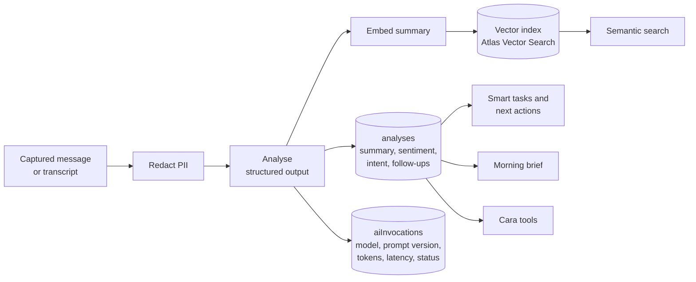
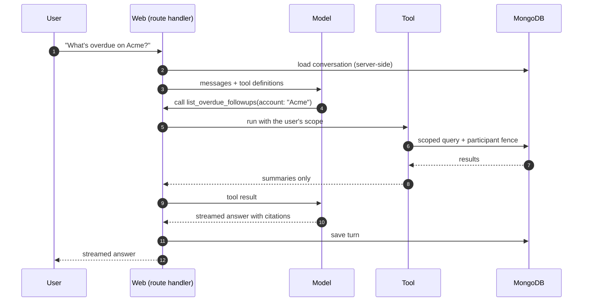

# AI layer

All of this is **planned**. The design rule: raw email and transcript text
reaches a model in exactly one place, the analysis pipeline, and only after
redaction. Everything interactive works from stored analysis.

## Pipeline

| Feature | Model call | Trigger | What the model sees |
| --- | --- | --- | --- |
| Email analysis | structured generation + embedding | new matched email | redacted subject and body, sender, time |
| Meeting analysis | structured generation (map-reduce for long transcripts) + embedding | transcript ready | redacted transcript, organiser, attendees |
| Cara chat | streamed generation with tools, max 8 steps | user message | conversation + tool results (summaries, never bodies) |
| Morning brief | generation | user opens the brief | task titles, flagged summaries, quiet accounts |
| Account summary | generation | button on the profile | account facts, recent summaries, open tasks |
| Smart tasks / next actions | none (reuses analysis follow-ups) | analysis written | — |
| Semantic search | embedding of the query only | search | the query |

## Cara's tool loop

Tools: `create_followup_task`, `log_note` (write), `find_similar_emails`,
`get_account_summary`, `list_overdue_followups` (read). Each tool re-checks
visibility, writes with an audit row in one transaction, and shows the user what
it did.

## Guardrails

- Prompts are versioned modules; outputs are parsed with Zod schemas.
- One write path stores an analysis together with its `aiInvocations` row.
- The participant fence applies to every content query feeding a prompt.
- Captured text is treated as untrusted: it never becomes instructions, and write
  tools act only on the signed-in user's request.
- Per-tenant token budgets and rate limits; analysis runs on a queue so spikes
  queue rather than fail.

## Provider

Calls go through the Vercel AI SDK so the provider is a configuration choice.
See [ADR 0006](decisions/0006-ai-provider.md).
