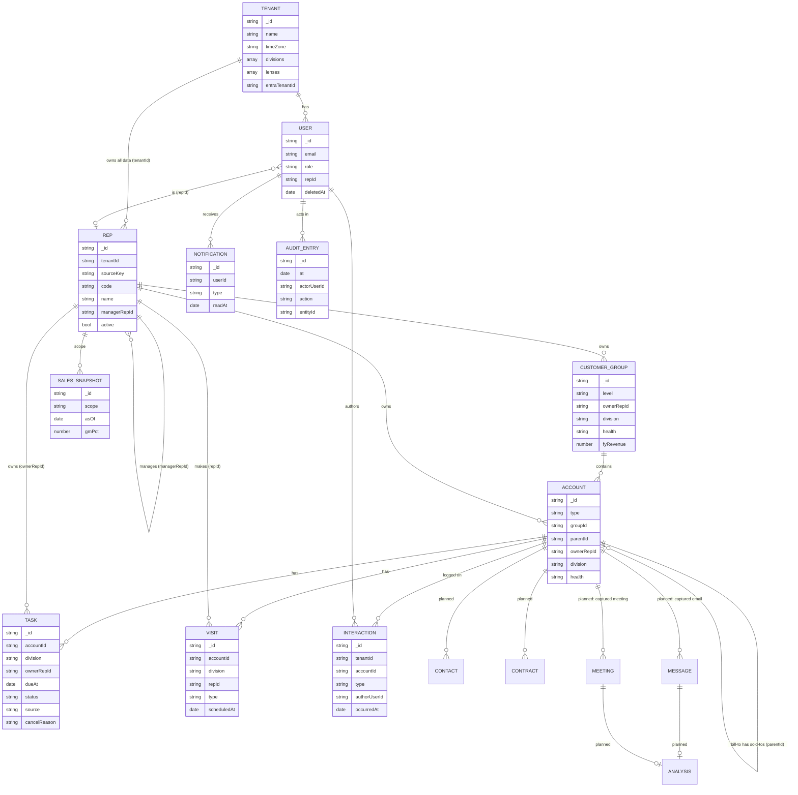

# Data model

All shapes are Zod schemas in [`packages/db/src/models.ts`](../../packages/db/src/models.ts);
TypeScript types are inferred from them. Indexes live in
[`packages/db/src/indexes.ts`](../../packages/db/src/indexes.ts).

## Ownership classes

Every collection belongs to exactly one class, and the class decides who may
write it.

| Class | Collections | Rule |
| --- | --- | --- |
| **Tenant** | `tenants` | One per customer organisation. Everything else belongs to exactly one tenant. |
| **Mirror** | `reps`, `customerGroups`, `accounts`, `contracts` | Copied from the customer's systems nightly. Read-only in the app; deactivated, never deleted. |
| **Rollup** | `salesSnapshots` (later: open orders, stock, health) | Dated snapshots, append-only. The dashboard reads the latest per scope. |
| **App-native** | `users`, `tasks`, `visits`, `interactions`, `notifications`, later `contacts`, `messages`, `meetings`, `analyses`, `conversations` | Owned by Ambient. Soft-deleted with `deletedAt` / `deletedBy`. Synced back to the warehouse. |
| **Observability** | `auditLog`, later `aiInvocations`, `syncRuns` | Append-only; production credentials get insert but not update or delete. |

## Entities

Solid boxes exist today; the rest are planned.

## Conventions

- **IDs are strings.** Mirror records use `"<tenantId>:<sourceKey>"` and keep
  `sourceKey` (stable across syncs, unique across tenants); app-native records use
  UUIDs.
- **Every time is a `Date`** stored as UTC. Display and day boundaries use the
  tenant's `timeZone` (an IANA name such as `Australia/Sydney`): "today" is
  local midnight there, a due date picked as a day is stored at 17:00 there,
  and a date-range filter covers whole local days. The helpers live in
  `@ambient/db/time` (pure `Intl`, safe in client components).
- **Divisions are per tenant.** `tenants.divisions` lists `{ key, label }`;
  `tenants.lenses` lists `{ key, label, divisions }`, each lens naming the
  division keys it shows. A record's `division` is one of its tenant's keys;
  labels always come from the tenant, never from code.
- **Enums are strings validated by Zod**, never database-level enums, so adding
  a value is a code change only.
- **Denormalise for the hot filter.** Tasks and visits copy their account's
  `division` at write time so the division lens needs no join. Anything copied
  must be refreshed by the sync job when the source changes.
- **Soft delete app-native data** (`deletedAt`, `deletedBy`); every query adds
  `deletedAt: null`.
- **Bodies live in blob storage.** Captured email bodies and transcripts are
  stored outside MongoDB; the database keeps a short snippet, the blob pointer
  and the AI analysis.
- **Tenant on everything** ([ADR 0004](decisions/0004-multi-tenancy.md), built):
  every document has `tenantId`, every index starts with it, and every query gets
  it from `getScope()`.

## Indexes (built)

Every index below is prefixed with `tenantId` except where noted as global.

| Collection | Indexes | Serves |
| --- | --- | --- |
| `tenants` | `entraTenantId` unique (global, when set) | sign-in mapping |
| `reps` | `code` unique, `managerRepId` | hierarchy walks |
| `users` | `email` unique, `repId`; `entraOid` unique (global, when set) | sign-in, scope |
| `customerGroups` | `ownerRepId + fyRevenue`, `division + health`, `fyRevenue`, `name` | accounts list, health mix |
| `accounts` | `groupId + type`, `parentId`, `ownerRepId + type + fyRevenue`, `type + fyRevenue`, `code` unique | lists, drill-down, palette |
| `tasks` | `ownerRepId + status + dueAt`, `accountId + status` | dashboard, open-task counts |
| `visits` | `repId + scheduledAt`, `accountId` | calendar |
| `interactions` | `accountId + occurredAt` | profile timeline |
| `notifications` | `userId + createdAt` | feed |
| `salesSnapshots` | `scope + asOf` | latest snapshot |
| `auditLog` | `at`, `entity + entityId + at`, `actorUserId + at` | audit browser |
