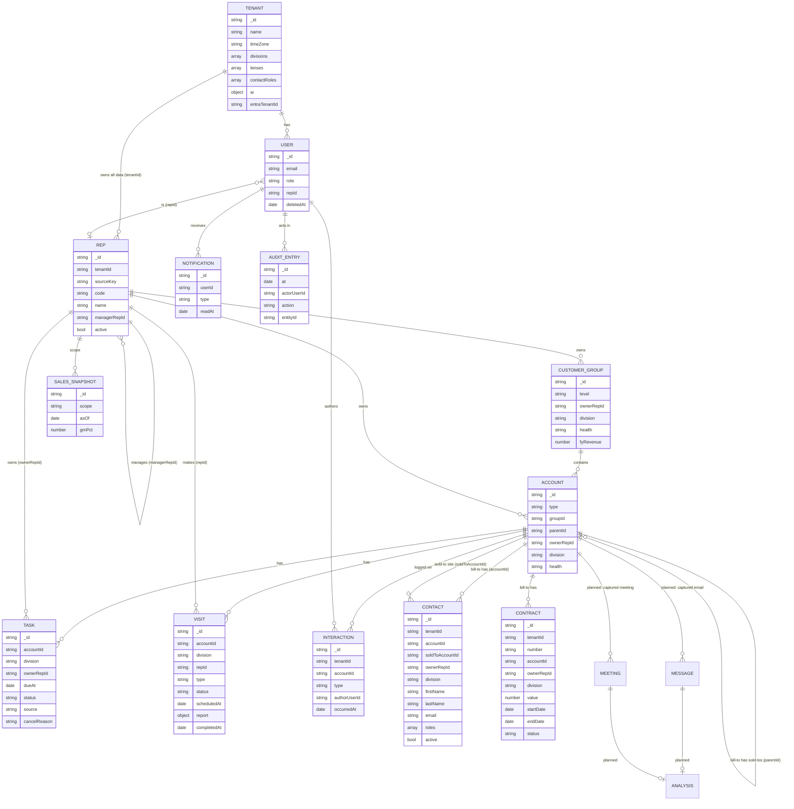

# Data model

All shapes are Zod schemas in [`packages/db/src/models.ts`](../../packages/db/src/models.ts);
TypeScript types are inferred from them. Indexes live in
[`packages/db/src/indexes.ts`](../../packages/db/src/indexes.ts).

## Ownership classes

Every collection belongs to exactly one class, and the class decides who may
write it.

| Class | Collections | Rule |
| --- | --- | --- |
| **Tenant** | `tenants` | One per customer organisation. Everything else belongs to exactly one tenant. |
| **Mirror** | `reps`, `customerGroups`, `accounts`, `contracts` | Copied from the customer's systems nightly. Read-only in the app; deactivated, never deleted. |
| **Rollup** | `salesSnapshots` (later: open orders, stock, health) | Dated snapshots, append-only. The dashboard reads the latest per scope. |
| **App-native** | `users`, `tasks`, `visits`, `interactions`, `contacts`, `notifications`, later `messages`, `meetings`, `analyses`, `conversations` | Owned by Ambient. Soft-deleted with `deletedAt` / `deletedBy`. Synced back to the warehouse. |
| **Observability** | `auditLog`, `aiInvocations` (plus the `aiUsage` budget ledger), later `syncRuns` | Append-only; production credentials get insert but not update or delete. |
| **Cache** | `aiOutputs` | Verified AI answers per user; replaced on regenerate, deleted after at most 7 days (TTL). |
| **Conversations** | `aiConversations` | A user's Wren chats; private, deletable, deleted 90 days after the last turn (TTL). |
| **Proposals** | `aiProposals` | Records Wren prepared for one user to accept; single use, deleted 7 days after creation (TTL). |
| **Feedback** | `aiFeedback` | Users' 👍 / 👎 on AI answers, one per user per answer; metadata only. |

## Entities

Solid boxes exist today; the rest are planned.

### Planned for the AI-first track

`aiActions` (each change Wren ran, with the state before for Undo), `aiInbox`
(background results and proposals), `aiMemories` (preferences a user asked
Wren to remember), `aiSkills` (tenant skills and versions) and `connections`
(connector connections with encrypted tokens); `auditLog` gains `via` (form,
Wren or job). Details: [AI-first design](ai-first.md#data-model-additions).

## Conventions

- **IDs are strings.** Mirror records use `"<tenantId>:<sourceKey>"` and keep
  `sourceKey` (stable across syncs, unique across tenants); app-native records use
  UUIDs.
- **Every time is a `Date`** stored as UTC. Display and day boundaries use the
  tenant's `timeZone` (an IANA name such as `Australia/Sydney`): "today" is
  local midnight there, a due date picked as a day is stored at 17:00 there,
  and a date-range filter covers whole local days. The helpers live in
  `@ambient/db/time` (pure `Intl`, safe in client components).
- **Divisions are per tenant.** `tenants.divisions` lists `{ key, label }`;
  `tenants.lenses` lists `{ key, label, divisions }`, each lens naming the
  division keys it shows. A record's `division` is one of its tenant's keys;
  labels always come from the tenant, never from code.
- **Enums are strings validated by Zod**, never database-level enums, so adding
  a value is a code change only.
- **Denormalise for the hot filter.** Tasks and visits copy their account's
  `division` at write time so the division lens needs no join; contacts also
  copy the bill-to's `ownerRepId`, so visibility needs no join either. Anything
  copied must be refreshed by the sync job when the source changes.
- **Visits** are on a bill-to and owned by the rep making them (`repId`, which
  visibility follows). `scheduledAt` is a moment on the tenant's clock. A
  completed visit carries `completedAt` and, once captured, a `report`
  (sentiment, three 1–5 ratings, key points, follow-ups); seeded and legacy
  completed visits may have no report yet.
- **Contracts** are Mirror headers on a bill-to. Start and end dates are local
  midnights in the tenant's zone, so "days left" is a whole number of calendar
  days; renewal bands are worked out at read time, never stored.
- **AI policy and usage.** `tenants.ai` holds the tenant's AI switch, allowed
  roles, enabled features and monthly token budget (off by default).
  `aiInvocations` has one row per AI request, refused or not, with metadata
  only: there is no field for prompt, facts or reply text. `aiUsage` is the
  monthly token ledger per tenant (`_id` = `tenantId:YYYY-MM` on the tenant's
  calendar), updated atomically. `aiOutputs` caches one verified answer per
  user, feature and subject (`_id` = `tenantId:userId:feature:subjectId`),
  with the facts fingerprint, prompt and policy versions and model it was
  built from, and the `cards` and `notes` it was shown with (a `day` feature
  such as the morning brief serves those as they were until local midnight);
  it holds the answer's text, so it is per user and expires (`expiresAt`,
  TTL). `aiInvocations.outcome` includes `cached`.
  `aiConversations` holds one user's Wren chat: a title, and turns (the
  question, or the verified answer with its bullets, follow-up question and
  the cards it was shown with). Only that user can read, continue or delete
  it; it is deleted 90 days after the last turn. Each answer lists the
  `proposalIds` it prepared. `aiProposals` holds one prepared task, visit or
  note for one user: the form's input, what the card shows, its status
  (`pending`, `accepting`, `accepted`, `dismissed`), what it created, where it
  came from (`chat`, or `followups` with the visit as `sourceId`); deleted 7
  days after creation. `aiFeedback` holds one user's 👍 / 👎 on one answer
  (`answerKey`: the subject and generation time of a summary or brief, or the
  chat turn), an optional fixed reason, and the prompt and policy versions and
  model that produced the answer; never its text. Chat answer turns record
  the same three for this. See [AI layer](ai.md).
- **Contacts** belong to a bill-to and optionally one of its sold-to sites.
  Emails are lowercased and unique per tenant among contacts that aren't
  deleted (checked in the write path, so deleted contacts can share one).
  Deactivating keeps a contact on past activity but drops it from pickers.
  Role tags come from the tenant's `contactRoles`.
- **Soft delete app-native data** (`deletedAt`, `deletedBy`); every query adds
  `deletedAt: null`.
- **Bodies live in blob storage.** Captured email bodies and transcripts are
  stored outside MongoDB; the database keeps a short snippet, the blob pointer
  and the AI analysis.
- **Tenant on everything** ([ADR 0004](decisions/0004-multi-tenancy.md), built):
  every document has `tenantId`, every index starts with it, and every query gets
  it from `getScope()`.

## Indexes (built)

Every index below is prefixed with `tenantId` except where noted as global.

| Collection | Indexes | Serves |
| --- | --- | --- |
| `tenants` | `entraTenantId` unique (global, when set) | sign-in mapping |
| `reps` | `code` unique, `managerRepId` | hierarchy walks |
| `users` | `email` unique, `repId`; `entraOid` unique (global, when set) | sign-in, scope |
| `customerGroups` | `ownerRepId + fyRevenue`, `division + health`, `fyRevenue`, `name` | accounts list, health mix |
| `accounts` | `groupId + type`, `parentId`, `ownerRepId + type + fyRevenue`, `type + fyRevenue`, `code` unique | lists, drill-down, palette |
| `tasks` | `ownerRepId + status + dueAt`, `accountId + status` | dashboard, open-task counts |
| `visits` | `repId + scheduledAt`, `scheduledAt`, `accountId` | call cycle, calendar, profile |
| `interactions` | `accountId + occurredAt` | profile timeline |
| `contracts` | `number` unique, `endDate`, `ownerRepId + endDate`, `accountId + endDate` | renewals list, band counts, profile card |
| `contacts` | `accountId + active`, `ownerRepId + lastName + firstName`, `lastName + firstName`, `email` | directory, profile card, duplicate-email check |
| `notifications` | `userId + createdAt` | dashboard feed, history page, unread counts |
| `salesSnapshots` | `scope + asOf` | latest snapshot |
| `auditLog` | `at`, `entity + entityId + at`, `actorUserId + at` | audit browser |
| `aiInvocations` | `createdAt`, `userId + createdAt`, `feature + createdAt` | rate limits, usage and cost reporting |
| `aiUsage` | `_id` only (`tenantId:month`) | budget reservations |
| `aiOutputs` | `_id` (`tenantId:userId:feature:subjectId`), `expiresAt` (TTL, single field), `feature + subjectId` | cache lookups, expiry |
| `aiConversations` | `userId + updatedAt`, `expiresAt` (TTL, single field) | the user's list, expiry |
| `aiProposals` | `userId + createdAt`, `createdAt`, `expiresAt` (TTL, single field) | the user's proposals, the admin report, expiry |
| `aiFeedback` | `_id` (`tenantId:userId:feature:answerKey`), `feature + createdAt` | one vote per answer, the admin report |
