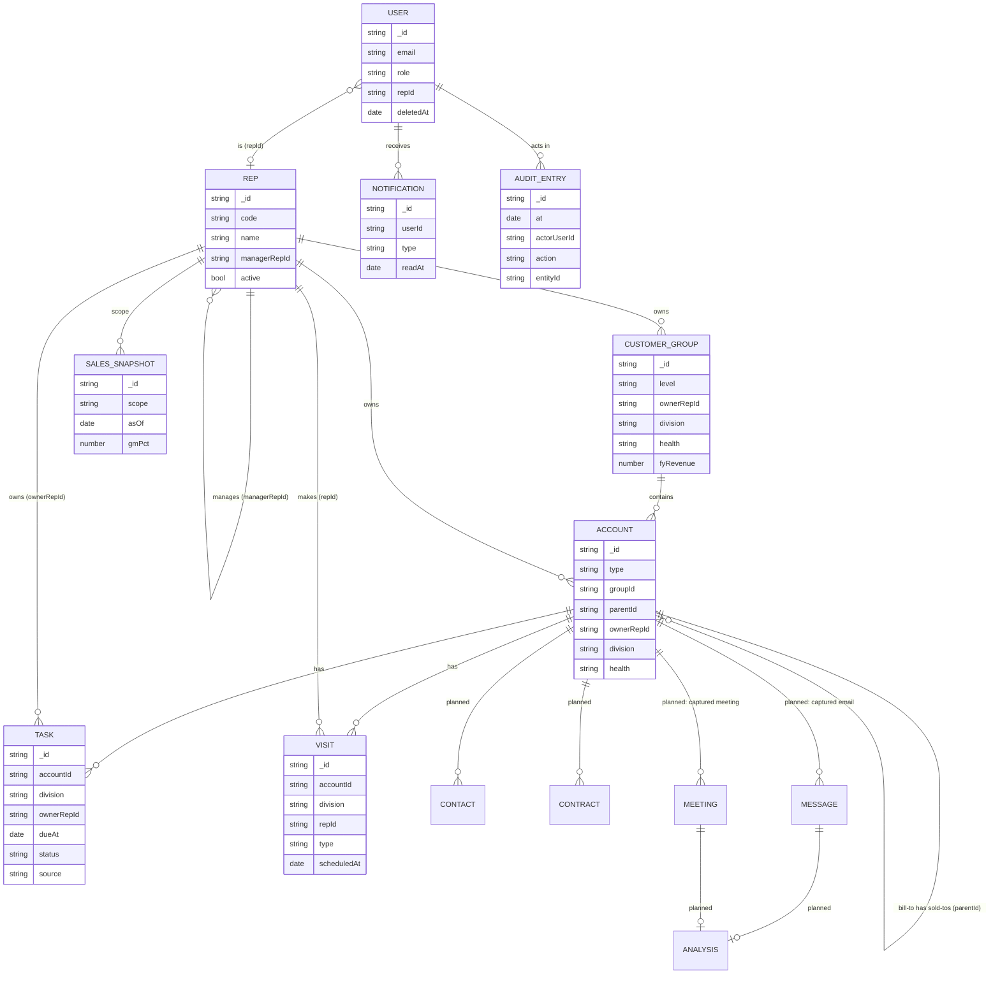

# Data model

All shapes are Zod schemas in [`packages/db/src/models.ts`](../../packages/db/src/models.ts);
TypeScript types are inferred from them. Indexes live in
[`packages/db/src/indexes.ts`](../../packages/db/src/indexes.ts).

## Ownership classes

Every collection belongs to exactly one class, and the class decides who may
write it.

| Class | Collections | Rule |
| --- | --- | --- |
| **Mirror** | `reps`, `customerGroups`, `accounts`, `contracts` | Copied from the customer's systems nightly. Read-only in the app; deactivated, never deleted. |
| **Rollup** | `salesSnapshots` (later: open orders, stock, health) | Dated snapshots, append-only. The dashboard reads the latest per scope. |
| **App-native** | `users`, `tasks`, `visits`, `notifications`, later `contacts`, `notes`, `messages`, `meetings`, `analyses`, `conversations` | Owned by Ambient. Soft-deleted with `deletedAt` / `deletedBy`. Synced back to the warehouse. |
| **Observability** | `auditLog`, later `aiInvocations`, `syncRuns` | Append-only; production credentials get insert but not update or delete. |

## Entities

Solid boxes exist today; the rest are planned.

## Conventions

- **IDs are strings.** Mirror records keep their source key (stable across
  syncs); app-native records use UUIDs.
- **Every time is a `Date`** stored as UTC. Display and day boundaries use the
  user's time zone (planned: per-tenant setting; today the server's zone).
- **Enums are strings validated by Zod**, never database-level enums, so adding
  a value is a code change only.
- **Denormalise for the hot filter.** Tasks and visits copy their account's
  `division` at write time so the division lens needs no join. Anything copied
  must be refreshed by the sync job when the source changes.
- **Soft delete app-native data** (`deletedAt`, `deletedBy`); every query adds
  `deletedAt: null`.
- **Bodies live in blob storage.** Captured email bodies and transcripts are
  stored outside MongoDB; the database keeps a short snippet, the blob pointer
  and the AI analysis.
- **Tenant on everything** (planned, see [ADR 0004](decisions/0004-multi-tenancy.md)):
  every document gets `tenantId`, and every index starts with it.

## Indexes (built)

| Collection | Indexes | Serves |
| --- | --- | --- |
| `reps` | `code` unique, `managerRepId` | hierarchy walks |
| `users` | `email` unique, `entraOid` unique (when set), `repId` | sign-in, scope |
| `customerGroups` | `ownerRepId`, `division + health` | health mix, lists |
| `accounts` | `groupId`, `parentId`, `ownerRepId + type`, `code` unique, text on `name + code` | lists, drill-down, palette |
| `tasks` | `ownerRepId + status + dueAt`, `accountId + status` | dashboard, task lists |
| `visits` | `repId + scheduledAt`, `accountId` | calendar |
| `notifications` | `userId + createdAt` | feed |
| `salesSnapshots` | `scope + asOf` | latest snapshot |
| `auditLog` | `at`, `entity + entityId + at`, `actorUserId + at` | audit browser |
