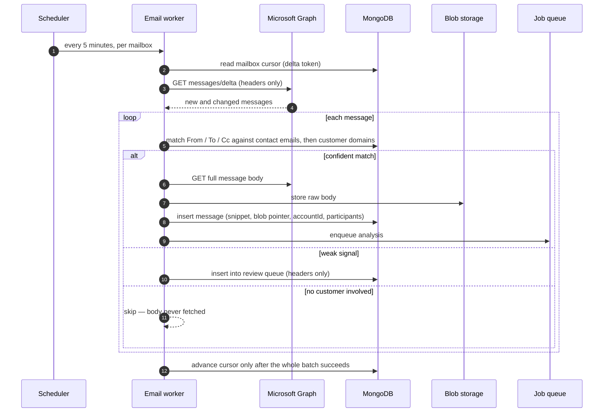
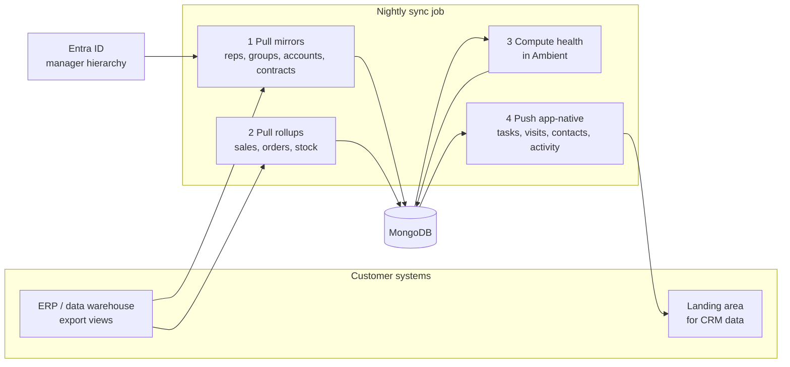
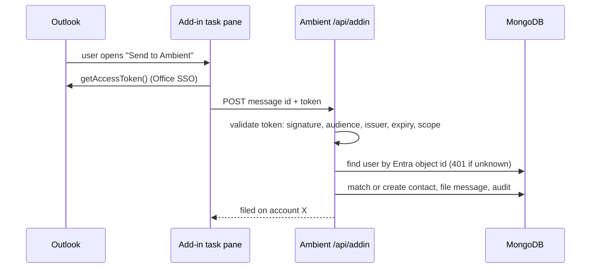

# Integrations

All integrations are **planned**. This document is the design they will be
built to.

## Email capture

A worker per tenant polls each in-scope mailbox through Microsoft Graph. Only
mail that involves a known customer address or domain is fetched in full.

Rules:
- The cursor advances only on success, so a failure re-scans rather than skips.
- Mailbox access is limited by an Exchange application access policy to the
  tenant's licensed users.
- Thread grouping uses Graph's `conversationId`.
- Backfill: adding a contact (or changing their email) can queue a one-off
  historical search for that address.

## Meeting capture

Same pattern every 30 minutes over calendars. Meetings with an external customer
attendee are recorded; once a Teams meeting ends, its transcript is fetched
(with a grace period for late transcripts) and queued for analysis.

## Warehouse and ERP sync

Mirror and rollup data comes from the customer's systems; app-native data goes
back so the customer's BI sees CRM activity.

Guardrails:
- Each dataset is one `syncRuns` row with counts and status; *aborted* (a guard
  tripped) is separate from *failed* (an error).
- A dataset that would deactivate more than a set share of its rows aborts
  instead of applying (protects against a broken export).
- Mirrors are upserted by source key; rows missing from the source are
  deactivated, never deleted.
- Connectors are per tenant behind one interface, so a new source system is a
  new adapter, not a new job.

## Outlook add-in

The add-in API is the only route outside normal web sign-in; CORS allows only
the add-in's own origin.

## BI

Reports are deep links into the customer's BI tool, not embedded. The report
library stores titles, descriptions and URLs per tenant.
