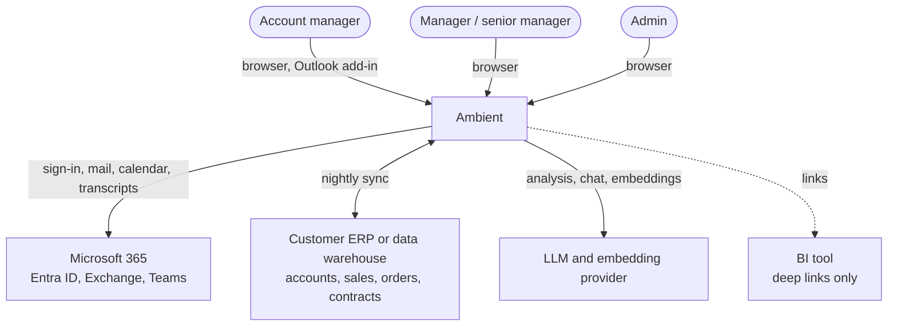
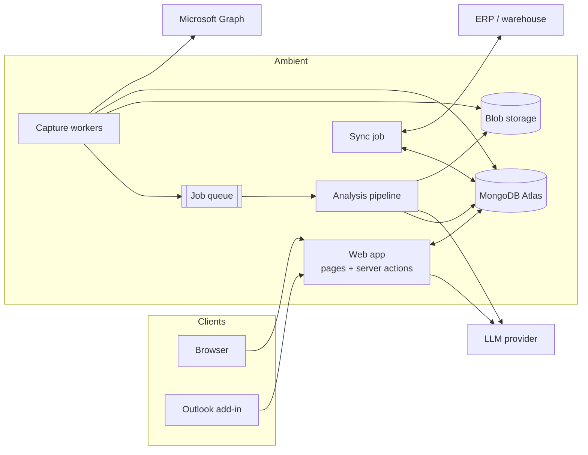
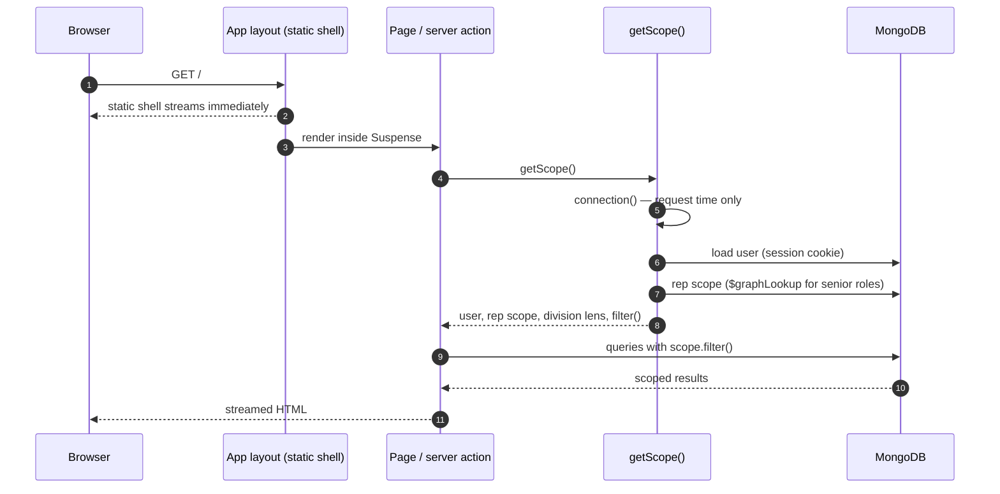

# Architecture overview

## System context

Who uses Ambient and what it talks to.



## Containers

| Container | Responsibility | Tech | Status |
| --- | --- | --- | --- |
| Web app | All pages, server actions, route handlers, Cara chat streaming | Next.js 16 (App Router, Cache Components), React 19 | Built (shell, dashboard) |
| Database | Operational store, vector index, audit log | MongoDB Atlas (replica set, Atlas Search and Vector Search) | Built (schema for current pages) |
| Capture workers | Poll Graph for mail and meetings, match, store, queue analysis | Node.js workers on a schedule | Planned |
| Analysis pipeline | Redact, analyse, embed captured content | AI SDK + LLM provider, queue-driven | Planned |
| Sync job | Pull mirror and rollup data from the customer's systems, push app-native data back | Node.js scheduled job | Planned |
| Outlook add-in | "Send to Ambient" from Outlook | React task pane, Office SSO | Planned |
| Blob storage | Raw email bodies and meeting transcripts | Object storage | Planned |



## Request lifecycle (built)

Every signed-in page and action follows the same path, so visibility can't be
forgotten.



## Code layout

```
apps/web
  app/layout.tsx            root: font, colour-mode boot script, toaster
  app/(app)/layout.tsx      signed-in shell: sidebar, top bar, palette, Cara tab
  app/(app)/**/page.tsx     one folder per route
  app/actions/              server actions (writes and palette search)
  components/shell/         shell pieces; slots.tsx loads their data on the server
  components/ui/            design-system primitives
  components/dashboard/     dashboard client widgets
  lib/auth/                 session, roles, visibility
  lib/data/                 server-only read models (scope.ts, dashboard.ts)
packages/db
  src/models.ts             Zod schemas → TypeScript types
  src/client.ts             one MongoClient per process, typed collections
  src/indexes.ts            index definitions
  scripts/                  seed, indexes, inspect
```

## Quality attributes

| Attribute | How it is met |
| --- | --- |
| Correct access | One scope function for every query; writes re-check scope in a transaction |
| Traceability | Audit row for every write; AI invocation log for every model call (planned) |
| Speed | Static shell streams first; per-user data streams behind Suspense; indexed queries |
| Privacy | Participant fence on captured content; PII redaction before AI; no secrets in git |
| Evolvability | Zod models in one package; decision records for every significant choice |
