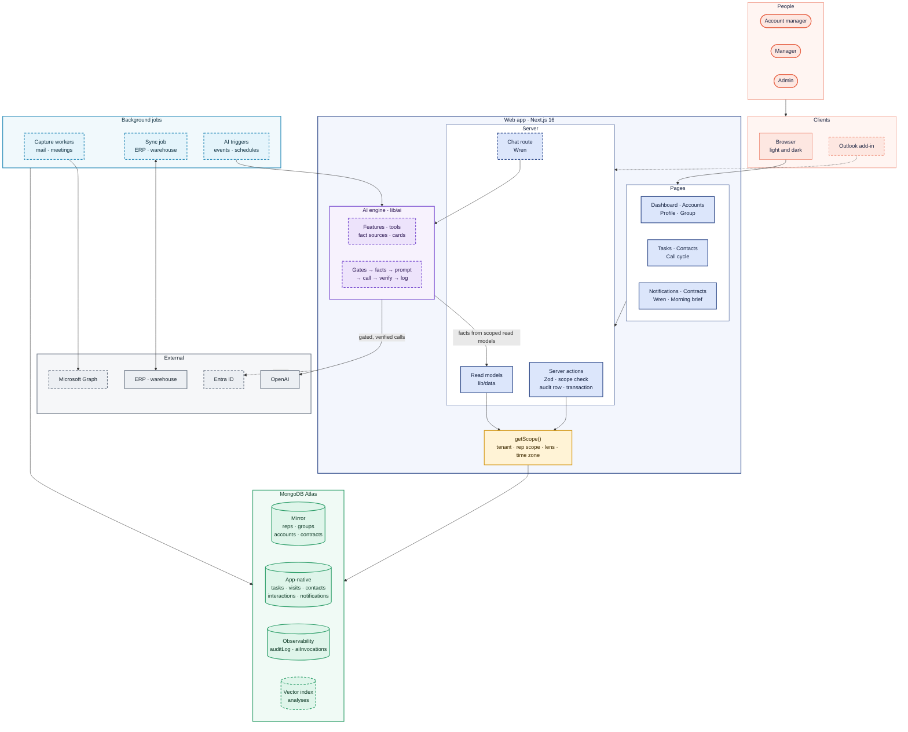
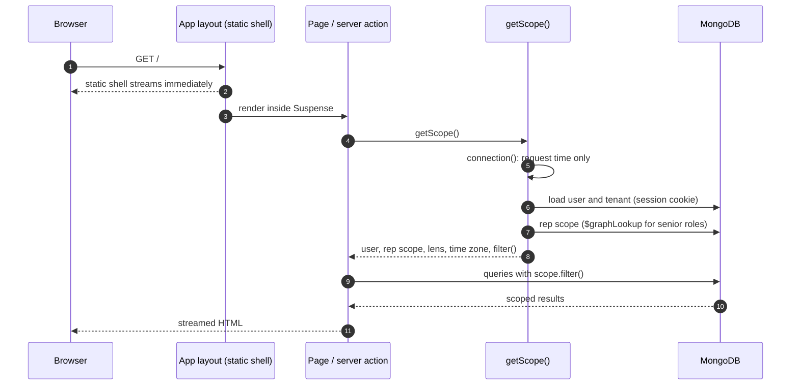

# Architecture overview

Colour key used in every diagram on this page: coral = people · navy = web
app · violet = AI engine · amber = safety · green = Ambient data · teal =
background jobs · grey = external systems. Dashed boxes are planned.

## System context

Who uses Ambient and what it talks to.


## The whole application

Every layer, what exists today and what is planned.



What each layer does:

| Layer | Responsibility | Status |
| --- | --- | --- |
| Pages | Every signed-in screen; per-user content streams inside Suspense | Built (Phase 2); Wren and Morning brief planned |
| Server actions | Every write: Zod, scope re-check, audit row, one transaction | Built |
| Read models | Every read, through `getScope()` | Built |
| `getScope()` | Tenant, rep scope, division lens, tenant time zone: the one door to data | Built |
| AI engine | Features, tools, fact sources and cards run inside one safety layer ([AI layer](ai.md)) | Planned (step 1 next) |
| Background jobs | Mail and meeting capture, ERP sync, AI triggers | Planned |
| MongoDB Atlas | Mirror, app-native and observability collections; vector index later | Built (vector index planned) |
| External | Entra sign-in, Graph, ERP, OpenAI | Planned |

## Containers

| Container | Responsibility | Tech | Status |
| --- | --- | --- | --- |
| Web app | All pages, server actions, route handlers, Wren chat | Next.js 16 (App Router, Cache Components), React 19 | Built (core CRM) |
| AI engine | Gated, scoped, verified model calls for every AI feature | Vercel AI SDK + OpenAI, inside the web app | Planned |
| Database | Operational store, audit log, AI usage log, vector index | MongoDB Atlas (replica set, Atlas Search and Vector Search) | Built (vector index planned) |
| Capture workers | Poll Graph for mail and meetings, match, store, queue analysis | Node.js workers on a schedule | Planned |
| Sync job | Pull Mirror and rollup data, push app-native data back | Node.js scheduled job | Planned |
| Outlook add-in | "Send to Ambient" from Outlook | React task pane, Office SSO | Planned |
| Blob storage | Raw email bodies and meeting transcripts | Object storage | Planned |
| CI | Lint, typecheck, unit and integration tests, build on every push | GitHub Actions + throwaway MongoDB | Built |

## Request lifecycle (built)

Every signed-in page and action follows the same path, so visibility can't be
forgotten.



## Code layout

```
apps/web
  app/layout.tsx            root: font, colour-mode boot script, toaster
  app/(app)/layout.tsx      signed-in shell: sidebar, top bar, palette, Wren tab
  app/(app)/**/page.tsx     one folder per route
  app/actions/              server actions, one file per area
  components/<area>/        dialogs and controls per area
  components/shell/         shell pieces; slots.tsx loads their data on the server
  components/ui/, forms/    design-system primitives, shared form fields
  lib/auth/                 session, roles, visibility
  lib/data/                 server-only read models (scope.ts and one per area)
  lib/*.ts                  pure rules shared by server and client
  lib/ai/                   AI engine (planned; see AI layer)
  tests/                    integration suites and support
packages/db
  src/models.ts             Zod schemas → TypeScript types
  src/client.ts             one MongoClient per process, typed collections
  src/indexes.ts            index definitions
  src/fixtures.ts           fictional demo data for seed and tests
  src/time.ts               tenant-calendar helpers
  scripts/                  seed, indexes, inspect
.github/workflows/ci.yml    CI
```

## Quality attributes

| Attribute | How it is met |
| --- | --- |
| Correct access | One scope function for every query; writes re-check scope in a transaction; AI facts come only from scoped fact sources |
| Traceability | Audit row for every write; AI usage log for every model call (planned) |
| Speed | Static shell streams first; per-user data streams behind Suspense; indexed queries; AI outputs cached until their facts change |
| Privacy | Participant fence on captured content; redaction before AI; no content in logs; no secrets in git |
| Evolvability | Zod models in one package; AI capabilities as one-file definitions on one engine; decision records for every significant choice |
| Quality gate | CI on every push; AI evaluation set on every prompt or model change |
