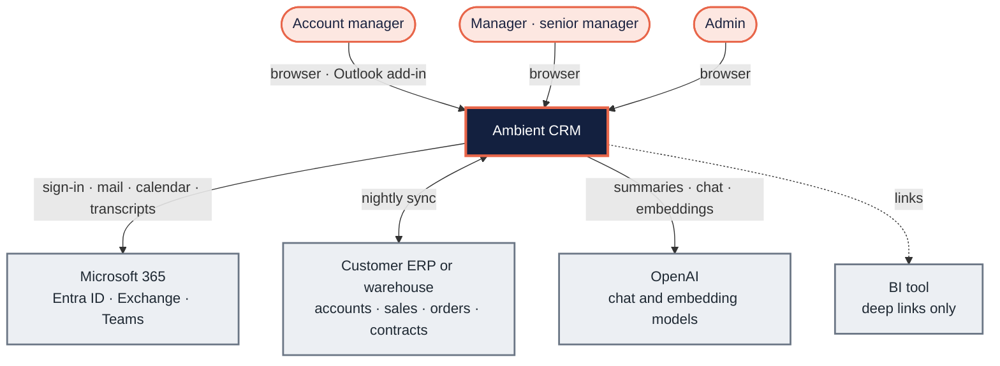
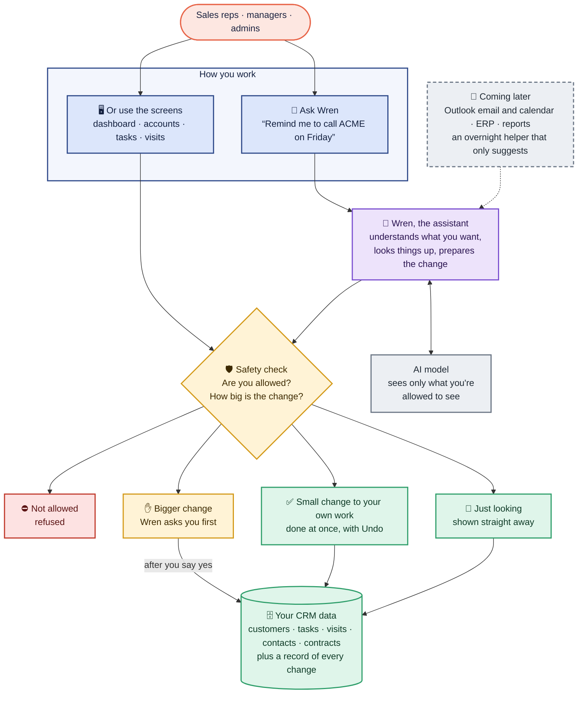
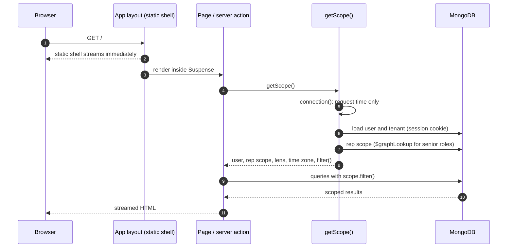

# Architecture overview

Colour key used in every diagram on this page: coral = people · navy = web
app · violet = AI engine · amber = safety · green = Ambient data · teal =
background jobs · grey = external systems. Dashed boxes are planned.

## System context

Who uses Ambient and what it talks to.



## The whole application

At a glance:



In one sentence: **Wren works out what you want; Ambient's rules decide
what's allowed.** You can ask Wren or use the screens; either way every request
goes through the same safety check before anything changes. Today Wren can
look things up and suggest tasks, visits and notes; doing everything for you
is what the [AI-first plan](../plans/ai-first-plan.md) builds next.

<details>
<summary><b>Show the full diagram</b> (for engineers: every layer, built and planned)</summary>

Every layer, what exists today (solid) and what is planned (dashed, with its
work package or AI-first phase). The rule it enforces: **the model chooses
intent; the application chooses authority.** Pages, Wren, admin pages, jobs
and connectors all go through one action registry and policy, so Wren can
never do more than the user can. Design:
[AI-first design](ai-first.md) ([ADR 0008](decisions/0008-ai-first.md)).

```mermaid
flowchart TB
  %% ---------- People ----------
  rep(["Account manager"])
  mgr(["Manager · senior · lead"])
  adm(["Admin · super admin"])

  %% ---------- Ways in ----------
  subgraph clients["Ways in"]
    direction LR
    pages["Pages<br/>dashboard · accounts · profile · tasks<br/>call cycle · contacts · contracts · notifications"]
    wren["Wren<br/>chat page · side panel · Ctrl K"]
    adminui["Admin pages<br/>settings · users · audit · AI policy<br/>(1.2–1.5, G)"]
    inbox["Wren inbox<br/>approve or dismiss (F)"]
    addin["Outlook add-in (5.5)"]
  end

  %% ---------- Web app ----------
  subgraph web["Next.js web app · apps/web"]
    direction TB
    edge["proxy.ts · request id<br/>sign-in: dev stand-in → Entra ID (2.2)"]

    subgraph agent["Wren agent · lib/ai"]
      direction LR
      gates["Gates<br/>key · tenant policy · role<br/>budget · rate limit"]
      loop["Agent loop<br/>today: 5 read + 3 propose tools<br/>next: plan · steps · caps · Stop (B)"]
      router["Tool routing<br/>groups on demand (B)"]
      facts["Facts<br/>scoped · handles · allowed fields<br/>untrusted text fenced"]
      verify["Verify<br/>schema · cited handles · limits"]
      skills["Skills (D)"]
      views["Cards and views<br/>rendered from records (views: C)"]
      gates --> loop
      loop --> facts
      facts -->|"facts as context"| loop
      loop --> router
      loop --> verify --> views
      skills --> loop
    end

    subgraph platform["Action platform · lib/actions (A)"]
      direction TB
      registry["Action registry<br/>typed input · permission · risk floor<br/>idempotency key · version"]
      policy{"Policy decision<br/>code rules, never the model"}
      approval["Approval card<br/>bound to action · input · user · tenant<br/>expires · single use"]
      refuse["Refused<br/>never by AI: users · roles · settings"]
      undo["Undo record · aiActions<br/>Undo runs as a new action"]
      registry --> policy
      policy -->|"medium · high"| approval
      approval -->|"confirm, re-checked"| registry
      policy -->|never| refuse
    end

    readmodels["Read models · lib/data<br/>getScope(): tenant · visibility · lens"]
    writes["Server write<br/>today: app/actions + lib/writes<br/>scope re-read · version · one transaction · audit row"]
  end

  %% ---------- Background ----------
  subgraph bg["Background (Wave 2 onwards)"]
    direction LR
    jobs["Job runner (2.3)<br/>Wren runs: 7am brief · renewal check<br/>system jobs: renewal nudges"]
    capture["Capture workers (5.1)<br/>fetch · redact · match"]
    review["Review queue (5.2)"]
    sync["Warehouse sync (4.1)<br/>guardrails · syncRuns"]
    conns["Connectors (E)<br/>on demand · encrypted tokens<br/>shares the Graph client with capture"]
  end

  %% ---------- Data ----------
  subgraph data["MongoDB Atlas · tenantId on every document"]
    direction LR
    crm[("CRM data<br/>mirror: accounts · groups · contracts<br/>app: tasks · visits · contacts · notes")]
    aidata[("AI data<br/>aiOutputs · aiConversations · aiProposals<br/>aiInvocations · aiUsage · aiFeedback")]
    aiplan[("Planned<br/>aiActions · aiInbox · aiMemories<br/>aiSkills · connections")]
    audit[("auditLog<br/>actor · via: form · Wren · system job<br/>request id · outcome")]
  end

  %% ---------- External ----------
  openai["OpenAI<br/>fast · strong tiers"]
  m365["Microsoft 365<br/>mail · calendar · Teams"]
  erp["ERP · data warehouse"]
  bi["BI tool"]
  mcp["Approved MCP servers (E.5)"]

  %% ---------- Flows ----------
  rep --> pages
  rep --> wren
  rep --> inbox
  rep --> addin
  mgr --> pages
  mgr --> wren
  adm --> adminui

  pages --> edge
  wren --> edge
  adminui --> edge
  addin --> edge
  edge --> gates
  edge --> registry

  loop <-->|"prompt + facts only"| openai
  facts --> readmodels
  router --> registry

  policy -->|read| readmodels
  policy -->|low| writes
  writes -->|"low, from Wren"| undo
  undo -. "Undo" .-> registry

  readmodels --> crm
  writes --> crm
  writes --> audit
  undo --> aiplan
  gates --> aidata
  verify --> aidata

  jobs -->|"Wren runs, as the user"| gates
  loop -. "background: proposals only" .-> inbox
  inbox -->|approve| approval
  jobs -->|system jobs| registry

  m365 --> capture --> crm
  capture --> review
  erp --> sync --> crm
  registry --> conns
  conns <--> m365
  conns <--> erp
  conns <--> bi
  conns <--> mcp

  %% ---------- Styles ----------
  classDef person fill:#FDE7E1,stroke:#E8664A,stroke-width:2px,color:#1B2340;
  classDef uiNode fill:#DCE6FB,stroke:#2F4A8A,stroke-width:2px,color:#13203F;
  classDef engineNode fill:#EDE3FB,stroke:#7B4FD0,stroke-width:2px,color:#2A1450;
  classDef safety fill:#FFF3D6,stroke:#D49A1A,stroke-width:2px,color:#3D2A00;
  classDef dataNode fill:#DFF5EA,stroke:#2E9E6A,stroke-width:2px,color:#0F3B27;
  classDef jobNode fill:#E4F4FB,stroke:#2B8CB8,stroke-width:2px,color:#0D2F3F;
  classDef external fill:#ECEFF3,stroke:#6B7685,stroke-width:2px,color:#1F2933;
  classDef planUi fill:#DCE6FB,stroke:#2F4A8A,stroke-width:2px,stroke-dasharray:6 4,color:#13203F;
  classDef planEngine fill:#EDE3FB,stroke:#7B4FD0,stroke-width:2px,stroke-dasharray:6 4,color:#2A1450;
  classDef planSafety fill:#FFF3D6,stroke:#D49A1A,stroke-width:2px,stroke-dasharray:6 4,color:#3D2A00;
  classDef planData fill:#DFF5EA,stroke:#2E9E6A,stroke-width:2px,stroke-dasharray:6 4,color:#0F3B27;
  classDef planJob fill:#E4F4FB,stroke:#2B8CB8,stroke-width:2px,stroke-dasharray:6 4,color:#0D2F3F;
  classDef planExt fill:#ECEFF3,stroke:#6B7685,stroke-width:2px,stroke-dasharray:6 4,color:#1F2933;

  class rep,mgr,adm person;
  class pages,wren,edge uiNode;
  class adminui,inbox,addin planUi;
  class loop,views engineNode;
  class router,skills planEngine;
  class gates,facts,verify,readmodels,writes safety;
  class registry,policy,approval,refuse,undo planSafety;
  class crm,aidata,audit dataNode;
  class aiplan planData;
  class jobs,capture,review,sync,conns planJob;
  class openai,m365,erp,bi external;
  class mcp planExt;

  style clients fill:#F3F6FD,stroke:#2F4A8A,stroke-width:2px,color:#13203F
  style web fill:#FAFBFE,stroke:#2F4A8A,stroke-width:2px,color:#13203F
  style agent fill:#F7F2FD,stroke:#7B4FD0,stroke-width:2px,color:#2A1450
  style platform fill:#FFFAEB,stroke:#D49A1A,stroke-width:2px,stroke-dasharray:6 4,color:#3D2A00
  style bg fill:#F1F9FC,stroke:#2B8CB8,stroke-width:2px,stroke-dasharray:6 4,color:#0D2F3F
  style data fill:#F0FAF5,stroke:#2E9E6A,stroke-width:2px,color:#0F3B27
```



How to read it:

- **The policy returns a decision:** read goes to the read models; low writes
  at once and saves an Undo record; medium and high wait for an approval card
  bound to that exact change, which goes back through the registry and is
  checked again; never is refused. Undo itself runs as a new action, with
  the same scope and version checks.
- **The model only sees facts:** the loop asks for facts, the facts come from
  scoped read models, and only the prompt and those facts go to OpenAI.
- **Background work goes through the gates** and only ever creates inbox
  proposals; approving one uses the same approval card. System jobs (renewal
  nudges, for example) call the registry directly.
- **Capture and sync are system integrations**, not Wren actions: capture
  files mail and meetings (and fills the review queue), sync reads the
  warehouse into the mirror data behind guardrails. Connectors are Wren's
  on-demand actions on outside systems.
- **Today's path:** pages call the server actions in `app/actions` and
  `lib/writes` directly, and Wren has 5 read and 3 propose tools; phase A puts
  both on the action registry.

</details>

What each layer does:

| Layer | Responsibility | Status |
| --- | --- | --- |
| Pages | Every signed-in screen; per-user content streams inside Suspense | Built |
| Wren agent (`lib/ai`) | Gates, scoped facts with handles, prompts, verification, cards; summaries, the morning brief, chat with read and propose tools, follow-ups, evaluation | Built; agent loop and tool routing (B), views (C), skills (D) planned |
| Action platform (`lib/actions`) | Action registry, policy decision, approval cards, Undo | Planned (A) |
| Read models | Every read, through `getScope()` | Built |
| Server writes | Zod, scope re-read, audit row, one transaction | Built; move onto actions with idempotency keys and version checks (A) |
| `getScope()` | Tenant, rep scope, division lens, tenant time zone: the one door to data | Built |
| Background | Job runner, capture and the review queue, warehouse sync, connectors | Planned (2.3, 5.1, 5.2, 4.1, E) |
| MongoDB Atlas | CRM data, AI data, audit log; the AI-first collections and a vector index later | Built (AI-first collections and vector index planned) |
| External | OpenAI (built, needs the key); Microsoft 365, ERP, BI, MCP servers; Entra ID sign-in | Planned except OpenAI |

## Containers

| Container | Responsibility | Tech | Status |
| --- | --- | --- | --- |
| Web app | All pages, server actions, route handlers, Wren chat | Next.js 16 (App Router, Cache Components), React 19 | Built |
| AI engine | Gated, scoped, verified model calls for every AI feature | Vercel AI SDK + OpenAI, inside the web app | Built (steps 1–7); the AI-first agent planned |
| Database | Operational store, audit log, AI usage log, vector index | MongoDB Atlas (replica set, Atlas Search and Vector Search) | Built (vector index planned) |
| Capture workers | Poll Graph for mail and meetings, match, store, queue analysis | Node.js workers on a schedule | Planned |
| Sync job | Pull Mirror and rollup data, push app-native data back | Node.js scheduled job | Planned |
| Outlook add-in | "Send to Ambient" from Outlook | React task pane, Office SSO | Planned |
| Blob storage | Raw email bodies and meeting transcripts | Object storage | Planned |
| CI | Lint, typecheck, unit, integration and end-to-end tests, build on every push | GitHub Actions + throwaway MongoDB (Atlas Local) + Playwright | Built |

## Request lifecycle (built)

Every signed-in page and action follows the same path, so visibility can't be
forgotten.



## Code layout

```
apps/web
  app/layout.tsx            root: font, colour-mode boot script, toaster
  app/(app)/layout.tsx      signed-in shell: sidebar, top bar, palette, Wren tab
  app/(app)/**/page.tsx     one folder per route
  app/actions/              server actions, one file per area
  components/<area>/        dialogs and controls per area
  components/shell/         shell pieces; slots.tsx loads their data on the server
  components/ui/, forms/    design-system primitives, shared form fields
  lib/auth/                 session, roles, visibility
  lib/data/                 server-only read models (scope.ts and one per area)
  lib/*.ts                  pure rules shared by server and client
  lib/ai/                   AI engine (planned; see AI layer)
  tests/                    integration suites and support
packages/db
  src/models.ts             Zod schemas → TypeScript types
  src/client.ts             one MongoClient per process, typed collections
  src/indexes.ts            index definitions
  src/fixtures.ts           fictional demo data for seed and tests
  src/time.ts               tenant-calendar helpers
  scripts/                  seed, indexes, inspect
.github/workflows/ci.yml    CI
```

## Quality attributes

| Attribute | How it is met |
| --- | --- |
| Correct access | One scope function for every query; writes re-check scope in a transaction; AI facts come only from scoped fact sources |
| Traceability | Audit row for every write; AI usage log for every model call (planned) |
| Speed | Static shell streams first; per-user data streams behind Suspense; indexed queries; AI outputs cached until their facts change |
| Privacy | Participant fence on captured content; redaction before AI; no content in logs; no secrets in git |
| Evolvability | Zod models in one package; AI capabilities as one-file definitions on one engine; decision records for every significant choice |
| Quality gate | CI on every push; AI evaluation set on every prompt or model change |
