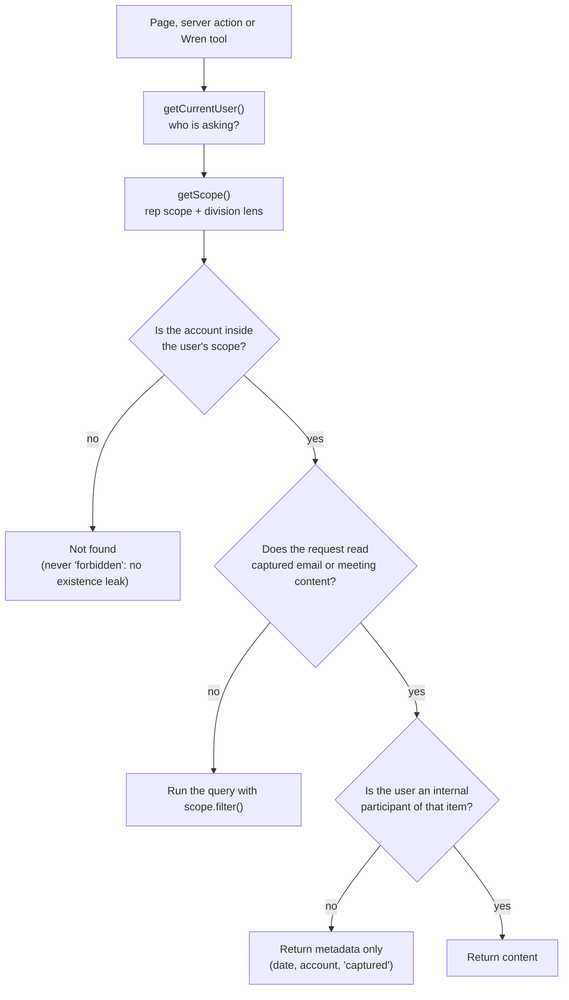

# Security and access

## Authentication

| Surface | Today (built) | Target (planned) |
| --- | --- | --- |
| Web app | Development sign-in: a cookie holding a seeded user id, switched from the gear menu. Only active when `AMBIENT_DEV_AUTH=1` and not in production; otherwise `getCurrentUser()` throws. | Microsoft Entra ID (OIDC, multi-tenant app registration). Users are matched by Entra object id, provisioned by an admin, never auto-created. See [ADR 0005](decisions/0005-hosting-and-sign-in.md). |
| Outlook add-in | — | Office SSO bearer token validated by the server: signature, audience, issuer, expiry, scope. Unknown users get 401. |
| Workers and sync | — | Service credentials from a secret store; least-privilege database users per job. |

## Authorisation: two checks, every time

1. **Account visibility** ([`lib/auth/visibility.ts`](../../apps/web/lib/auth/visibility.ts)) —
   built. User: own book. Manager: plus direct reports. Senior manager: plus the
   whole reporting subtree via `$graphLookup` on `managerRepId`. Lead and super
   admin: everything. Admin: nothing on its own.
2. **Participant fence** — planned with capture. Captured content is readable only
   by internal participants, for every role, including in prompts sent to the
   model. An empty participant set blocks access.

## Writes

Every write is a server action that:
1. parses input with Zod,
2. re-reads the target **inside the user's scope** (a missing row means "not found"),
3. writes the change and an `auditLog` row **in one transaction**,
4. refreshes the page.

[`app/actions/tasks.ts`](../../apps/web/app/actions/tasks.ts) is the reference
implementation.

## Audit

`auditLog` records actor, optional impersonated user, action, entity, id, and
before/after state. It never stores note or email bodies. Production database
users can insert into it but not update or delete.

## Data protection

- **Secrets** live in local, gitignored `.env` files in development and in a
  secret store in deployed environments. Nothing secret is committed; reviews
  check for connection strings.
- **Database access**: Atlas IP access list plus TLS; separate database users per
  environment and per job (planned).
- **PII redaction**: card numbers, bank details, tax and identity numbers are
  redacted before any text reaches a model (planned; start with a pattern pass,
  move to a managed PII service).
- **Data residency**: tenant data stays in the Atlas region chosen at onboarding;
  model calls use a provider region that matches (decision per tenant).
- **View-as** (support): super admin only, time-limited signed session, every
  action audited with `impersonatedUserId`, excluded from production unless
  explicitly enabled.

## Threats we design against

| Threat | Mitigation |
| --- | --- |
| A rep reads another team's accounts | Scope filter on every query; actions re-check scope |
| A manager reads a rep's private email | Participant fence applies to every role, no override |
| Cross-tenant data leak | `tenantId` on every document and index; every query takes it from `getScope()` (built; verified with two seeded tenants) |
| Prompt injection via captured email | Model sees summaries, not raw bodies, in interactive features; tools re-check scope and need user confirmation to write |
| Leaked credentials | No secrets in git; rotate on exposure; per-environment users |
| Tampering with history | Append-only audit log; soft delete only |
