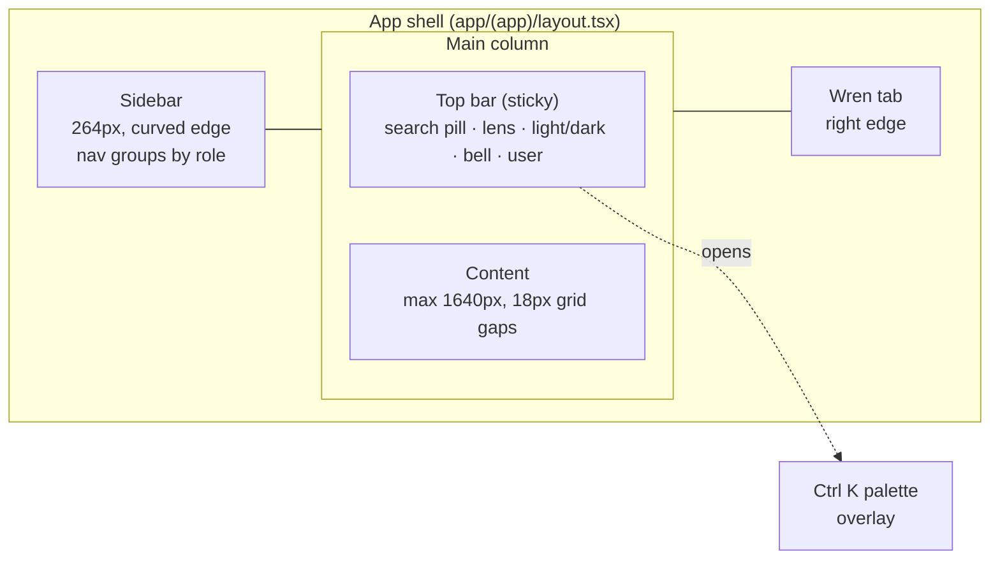

# Design system

Ambient has one brand palette, navy and coral, in light and dark modes. Tokens
are CSS custom properties in [`apps/web/app/globals.css`](../../apps/web/app/globals.css),
exposed to Tailwind as utilities (`bg-surface`, `text-muted`, `border-line`…).
Components are a small set of CSS classes plus React primitives in
[`apps/web/components/ui`](../../apps/web/components/ui). **Status: Built.**

## Colour tokens

| Token | Light | Dark | Use |
| --- | --- | --- | --- |
| `--bg` | `#f2f5f9` | `#0e1118` | page background |
| `--surface` / `2` / `3` | `#fff` / `#f6f7fb` / `#eceef6` | `#171b26` / `#1d2230` / `#252b3b` | cards, insets, tracks |
| `--text` / `--text2` / `--muted` | `#0e1b2a` / `#4a5165` / `#868da6` | `#eef0f7` / `#b7bdd1` / `#7f87a1` | primary, secondary, captions |
| `--line` / `--line2` | `#e6e8f1` / `#eff1f7` | `#2a3042` / `#222838` | borders, dividers |
| `--accent` / `--accent2` | `#e5755a` / `#cf5f45` | same | primary actions, active states, the brand mark |
| `--side` | `#0f2236` | `#0b1726` | sidebar |
| `--darkbtn` | `#04101d` | `#eef0f7` | high-contrast buttons, badges, bars |
| `--ok` / `--warn` / `--risk` / `--info` | `#1f9d63` / `#d98b0a` / `#dc3a2f` / `#3b6fd4` | same | health and status; each has a `-soft` tint |

Health is always shown with colour **and** a word (Healthy, Watch, At risk),
never colour alone.

## Type, shape and depth

- **Font:** Figtree (400–800) via `next/font`; monospace for codes and figures.
- **Scale:** page title 32/800, card title 16.5/800, body 14, caption 12.5,
  eyebrow 11.5 uppercase with tracking.
- **Radii:** cards 22px, tiles 20px, inputs 14px, pills and buttons fully round.
- **Shadow:** one soft card shadow (`--shadow`) and one overlay shadow (`--shadow-lg`).

## Layout

| Breakpoint | Behaviour |
| --- | --- |
| ≥ 1280px | Dashboard hero is five columns; KPI row is four |
| < 1280px | Hero collapses to two columns; three-column rows stack |
| < 1060px | Sidebar becomes a slide-in drawer behind a menu button; search pill shrinks to an icon; lens hidden |
| < 700px | Single column; secondary top-bar controls hidden |

## Components

| Class / primitive | What it is |
| --- | --- |
| `card`, `<Card>` | Surface with optional title and link |
| `kpi` | Metric card: label, value, caption, icon chip |
| `tile`, `tile add` | Quick-link tile; dashed "add" variant |
| `promo` | Accent gradient call-out (Wren) |
| `btn` + `primary` `dark` `soft` `ghost` `danger`, sizes `sm` `xs` `icon` | Buttons |
| `bdg` + tone, `<Badge>` | Status pill |
| `hp g/a/r`, `<HealthPill>` | Health label |
| `seg` | Segmented control (lens, light/dark) |
| `pop`, `mi`, `mh` | Menus (Radix dropdown) |
| `li`, `tk`, `evt` | List row, task row, event row |
| `bar`, `<ProgressBar>`; `<Ring>` | Progress bar; donut |
| `cal` | Week day picker |
| `sb-track` | Sales vs target bar with target marker |
| `<PageHead>`, `<Empty>`, `<Skeleton>`, `<Avatar>`, `<Dot>` | Page header, empty state, loading block, initials, legend dot |
| `<AmbientLogo>` | Wordmark; text uses `currentColor` |

## Light and dark mode

`html[data-dark="1"]` switches every token. An inline script in
`app/layout.tsx` reads the `amb_dark` cookie before first paint, so there is no
flash; the top-bar toggle and user menu update it.

## Accessibility

- Every icon-only control has an `aria-label`; segmented controls are radio groups.
- Focus states use the accent ring; menus and dialogs are Radix, so keyboard and
  screen-reader behaviour comes built in.
- Text on accent and navy meets WCAG AA at the sizes used.
- Motion is limited to short fades, lifts and the drawer slide.
