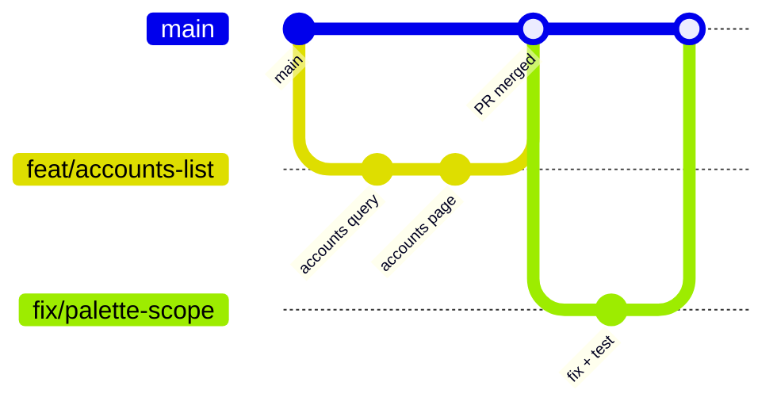

# Git workflow

## Branches

- `main` is always deployable and always green: CI (lint, typecheck, unit and
  integration tests, build) runs on every push and pull request. Requiring those
  checks before merging is a GitHub branch-protection setting to turn on once
  more than one person commits.
- Branch names: `feat/…`, `fix/…`, `docs/…`, `chore/…`.

## Commits

[Conventional Commits](https://www.conventionalcommits.org/):
`feat(accounts): list customer groups with health filter`. The subject says
what changed for the user; the body says why and anything a reviewer must know.

## Pull requests

Every PR:
- describes the change and how it was verified (commands run, pages checked);
- updates the docs it affects in the same PR;
- passes CI: lint, typecheck, unit and integration tests, and the build;
- contains **no secrets**: no connection strings, keys or tokens. `.env*` files
  are gitignored; check `git diff --cached` before committing.

## Releases

Planned with deployments (CD, after hosting is chosen): every merge to `main` deploys to staging; production deploys
are tagged `vYYYY.MM.DD` with release notes generated from commit subjects.
