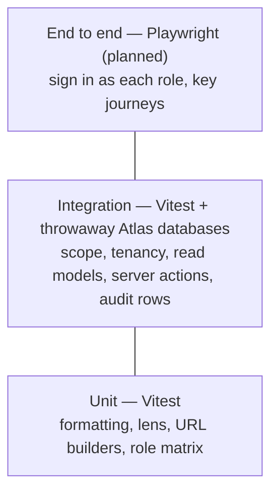

# Testing

**Status: built.** Vitest runs two projects: **unit** (pure logic, no
database) and **integration** (real read models and server actions against a
real MongoDB). Every feature ships with its tests in the same change.

```bash
pnpm test                                   # everything (integration runs on the Atlas cluster)
pnpm test:unit                              # unit only, no database
pnpm --filter web test:integration          # integration only
pnpm --filter web exec vitest run <file>    # one file
```

## Layers



| Layer | Where | What it covers |
| --- | --- | --- |
| Unit | `apps/web/lib/**/*.test.ts` | Pure functions: `format.ts`, `lens.ts`, `accounts-url.ts`, the role matrix |
| Integration | `apps/web/tests/integration/*.test.ts` | Visibility per role, tenant isolation, per-tenant divisions, lenses and time zones, accounts list and drill-down, customer and group pages, palette search, task create/edit/cancel/complete, interactions, audit-log privacy |
| End to end | — | Planned: Playwright against a seeded app |

## How integration tests work

`tests/support/integration-setup.ts` runs before every integration test file:

1. **The Atlas cluster, in a throwaway database.** It reads the cluster URI
   from `apps/web/.env.local` (or `TEST_MONGODB_URI`) and creates a database
   named `ambient_test_<epoch seconds>_<random>` for that file.
2. **Never the app's database.** `assertTestDb()` refuses any name without the
   `ambient_test_` prefix and the app's own `MONGODB_DB` (`ambient_crm`), before
   anything is created or dropped.
3. **Seeded with the demo data.** `seedDemoData()` from
   `@ambient/db/fixtures` loads both fictional tenants, the same data
   `pnpm db:seed` uses. Its collections are dropped when the file finishes.
4. **Next.js request APIs are stubbed** (`cookies`, `connection`, `refresh`),
   so tests call the real `getScope()`, read models and server actions.

`tests/support/global-setup.ts` runs once per suite and removes test databases
older than two hours, left by interrupted runs, so the cluster's database and
collection limits never fill up. Files run three at a time with generous
timeouts, because every query crosses the network (a full run takes about 30
seconds). To use a different cluster for tests, set `TEST_MONGODB_URI`.

Sign in as any seeded user with `signInAs()` from `tests/support/session.ts`:

```ts
signInAs(USERS.northwind.manager);            // Liam: own book + 4 reports
signInAs(USERS.northwind.senior, "uniforms"); // with a division lens
signInAs(USERS.harbor.super);                 // the second tenant
```

## Rules

- **Tests go in with the feature**, in the same pull request. A bug fix comes
  with the test that would have caught it.
- **Every data path gets an isolation test:** what a user outside the scope
  sees (nothing), and what another tenant sees (nothing).
- **Every write gets an audit test,** including that note, description and
  summary text never appears in the audit row.
- **Dates use the tenant's zone in tests too.** Build "today plus n days" with
  `addDays` and `isoDayIn` from `@ambient/db/time` and the tenant's zone, never
  `new Date()` arithmetic, so tests pass whatever the machine's zone.
- Assert on behaviour the user would notice (counts, names, error messages),
  not on implementation details.
- Tests only ever create, write and drop `ambient_test_*` databases; the guard
  enforces it and has its own unit test.

## Checking the tests themselves

When a suite passes first time, break the thing it guards and make sure it
fails. Removing `tenantId` from `getScope().filter()` fails four integration
tests (cross-tenant profile, task create, task complete, scope filter); that
check was run when the suite was added.

## Still to add

- End-to-end tests (Playwright) for sign-in per role, completing a task and
  logging an interaction through the real UI.
- A CI job that runs `pnpm test` on every pull request, with the test cluster
  URI stored as a repository secret.
