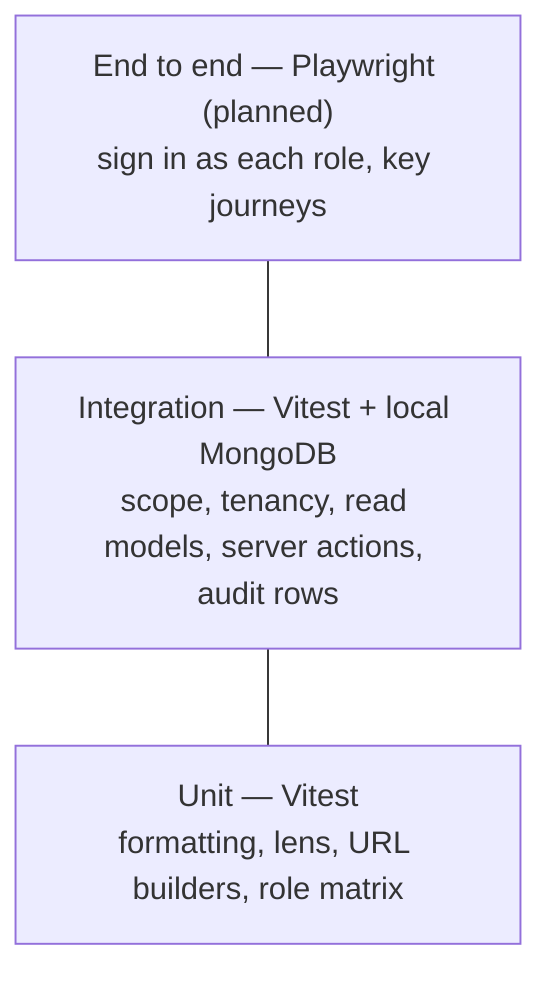

# Testing

**Status: built.** Vitest runs two projects: **unit** (pure logic, no
database) and **integration** (real read models and server actions against a
real MongoDB). Every feature ships with its tests in the same change.

```bash
pnpm test                                   # everything (needs local MongoDB: pnpm db:up)
pnpm test:unit                              # unit only, no database
pnpm --filter web test:integration          # integration only
pnpm --filter web exec vitest run <file>    # one file
```

## Layers



| Layer | Where | What it covers |
| --- | --- | --- |
| Unit | `apps/web/lib/**/*.test.ts` | Pure functions: `format.ts`, `lens.ts`, `accounts-url.ts`, the role matrix |
| Integration | `apps/web/tests/integration/*.test.ts` | Visibility per role, tenant isolation, accounts list and drill-down, customer and group pages, palette search, task create/edit/cancel/complete, interactions, audit-log privacy |
| End to end | — | Planned: Playwright against a seeded app |

## How integration tests work

`tests/support/integration-setup.ts` runs before every integration test file:

1. **A fresh database per file.** It points `MONGODB_URI` at a local MongoDB
   (`TEST_MONGODB_URI`, default the Docker container from `pnpm db:up`) and
   picks a random `ambient_test_<id>` database name.
2. **Seeded with the demo data.** `seedDemoData()` from
   `@ambient/db/fixtures` loads both fictional tenants, the same data
   `pnpm db:seed` uses. It is dropped when the file finishes.
3. **Refuses anything but localhost**, so tests can never touch Atlas or any
   shared database.
4. **Next.js request APIs are stubbed** (`cookies`, `connection`, `refresh`),
   so tests call the real `getScope()`, read models and server actions.

Sign in as any seeded user with `signInAs()` from `tests/support/session.ts`:

```ts
signInAs(USERS.northwind.manager);            // Liam: own book + 4 reports
signInAs(USERS.northwind.senior, "uniforms"); // with a division lens
signInAs(USERS.harbor.super);                 // the second tenant
```

## Rules

- **Tests go in with the feature**, in the same pull request. A bug fix comes
  with the test that would have caught it.
- **Every data path gets an isolation test:** what a user outside the scope
  sees (nothing), and what another tenant sees (nothing).
- **Every write gets an audit test,** including that note, description and
  summary text never appears in the audit row.
- Assert on behaviour the user would notice (counts, names, error messages),
  not on implementation details.
- Never point tests at a shared or remote database.

## Checking the tests themselves

When a suite passes first time, break the thing it guards and make sure it
fails. Removing `tenantId` from `getScope().filter()` fails four integration
tests (cross-tenant profile, task create, task complete, scope filter); that
check was run when the suite was added.

## Still to add

- End-to-end tests (Playwright) for sign-in per role, completing a task and
  logging an interaction through the real UI.
- A CI job that starts `mongodb-atlas-local` as a service and runs `pnpm test`
  on every pull request.
