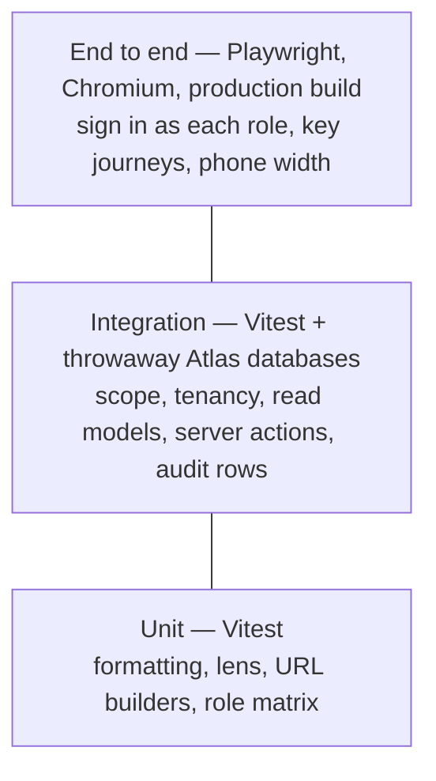

# Testing

**Status: built.** Vitest runs two projects: **unit** (pure logic, no
database) and **integration** (real read models and server actions against a
real MongoDB). Playwright runs the **end-to-end** tests: the production build
in Chromium, signed in as each role. Every feature ships with its tests in the
same change.

```bash
pnpm test                                   # everything (integration runs on the Atlas cluster)
pnpm test:unit                              # unit only, no database
pnpm --filter web test:integration          # integration only
pnpm --filter web exec vitest run <file>    # one file
pnpm test:e2e                               # end to end: build, seed a throwaway database, run Chromium
E2E_SKIP_BUILD=1 pnpm test:e2e              # the same, reusing the last build
pnpm --filter web exec playwright test e2e/tasks.spec.ts   # one file
```

## Layers



| Layer | Where | What it covers |
| --- | --- | --- |
| Unit | `apps/web/lib/**/*.test.ts`, `apps/web/tests/unit/*.test.ts` | Pure functions: `format.ts`, `lens.ts`, `accounts-url.ts`, contact and visit input rules, renewal bands, AI facts (builder, allowed fields, cut and fence, fingerprint, tenant-zone dates), verification, policy prompt and config, the account summary's limits, gaps and prompt (checked word for word against ai-prompts.md), the morning brief's headline, limits and prompt, the Wren chat prompt and every tool description (word for word against ai-prompts.md), follow-up limits and prompt, generic titles, evaluation scores and the baseline gate, the role matrix, request ids and the proxy; **architecture guards** |
| Integration | `apps/web/tests/integration/*.test.ts` | Visibility per role, tenant isolation, per-tenant divisions, lenses and time zones, contacts (directory, scope, create/edit/deactivate, duplicate emails, audit privacy), call cycle (weeks in the tenant zone, booking rules, reschedule, cancel, post-visit reports), notifications (own only, filters, day groups, mark read), contracts (bands in the tenant zone, counts, search, scope, profile card), the AI engine (gates, scoped facts, verification, retries, time limits, budget races, rate limits, metadata-only logging), AI fact sources (account and my day: scope per role, no email, phone or id, staff text fenced and cut, caps on a busy account, tenant zone) and cards (cited only, in order, `not_found` without a call), the account summary and its cache (verified and limited answers, cache hits with no call, tokens or rate-limit use, stale on any record change, Refresh, prompt and model changes, per user, hidden when AI is off, 7-day expiry, peek writes nothing), the morning brief and its day cache (urgency order, cards per item, code headline, a rep's and a manager's day, kept after records change with its own cards and flagged, Refresh, expiry at local midnight in Sydney and Auckland, per user, hidden when AI is off, the dashboard headline read writes nothing), Wren's read tools (scope per role, name matching that never reaches or lists another rep's accounts, ambiguity, shared handles, no email or phone in facts) and chat (tool calls with the stand-in, verified answers with cards, rejected uncited answers, marked answers without records, the 4-call cap, refusals, one rate-limit count per question, conversations saved and private and expiring, history without handles, the streaming route), proposals (propose tools refuse what isn't ready and write nothing else; Accept through the forms' code, marked from Wren, once under a double click, refused with the action's reason, only for its own user, not when dismissed or expired; chat answers with live proposal status) and follow-ups (verified suggestions as proposals, asked twice gives the same, only the user's own completed visits), feedback (versions and model recorded, no text, replaced by a later vote, only the user's own current answer) and the admin AI report (admins only, this tenant only, totals that match, no text), accounts list and drill-down, customer and group pages, palette search, task create/edit/cancel/complete, interactions, audit-log privacy |
| End to end | `apps/web/e2e/*.spec.ts` | What each role and the other tenant can see (accounts, another rep's account by address, admin pages), the role switcher, accounts list, search, group page and bill-to profile, logging an interaction, creating and completing a task, a manager assigning one to a rep (who is notified), the task form refusing a missing title, planning and reporting a visit, adding and finding a contact, contracts and their renewal filter (and another tenant not seeing them), notifications (one read, then all), every AI screen without a key (chat page, side panel, account summary, morning brief), dark mode remembered, and at phone width (390 px) the main pages fitting without sideways scrolling and the menu opening the navigation. Any browser console error fails a test |

## How integration tests work

`tests/support/integration-setup.ts` runs before every integration test file:

1. **The Atlas cluster, in a throwaway database.** It reads the cluster URI
   from `apps/web/.env.local` (or `TEST_MONGODB_URI`) and creates a database
   named `ambient_test_<epoch seconds>_<random>` for that file.
2. **Never the app's database.** `assertTestDb()` refuses any name without the
   `ambient_test_` prefix and the app's own `MONGODB_DB` (`ambient_crm`), before
   anything is created or dropped.
3. **Seeded with the demo data.** `seedDemoData()` from
   `@ambient/db/fixtures` loads both fictional tenants, the same data
   `pnpm db:seed` uses. Its collections are dropped when the file finishes.
4. **Next.js request APIs are stubbed** (`cookies`, `connection`, `refresh`),
   so tests call the real `getScope()`, read models and server actions.

`tests/support/global-setup.ts` runs once per suite and removes test databases
older than two hours, left by interrupted runs, so the cluster's database and
collection limits never fill up. Files run three at a time with generous
timeouts, because every query crosses the network (a full run takes about 30
seconds). To use a different cluster for tests, set `TEST_MONGODB_URI`.

Sign in as any seeded user with `signInAs()` from `tests/support/session.ts`:

```ts
signInAs(USERS.northwind.manager);            // Liam: own book + 4 reports
signInAs(USERS.northwind.senior, "uniforms"); // with a division lens
signInAs(USERS.harbor.super);                 // the second tenant
```

## Rules

- **Tests go in with the feature**, in the same pull request. A bug fix comes
  with the test that would have caught it.
- **Every data path gets an isolation test:** what a user outside the scope
  sees (nothing), and what another tenant sees (nothing).
- **Every write gets an audit test,** including that note, description and
  summary text never appears in the audit row.
- **Dates use the tenant's zone in tests too.** Build "today plus n days" with
  `addDays` and `isoDayIn` from `@ambient/db/time` and the tenant's zone, never
  `new Date()` arithmetic, so tests pass whatever the machine's zone.
- Assert on behaviour the user would notice (counts, names, error messages),
  not on implementation details.
- Tests only ever create, write and drop `ambient_test_*` databases; the guard
  enforces it and has its own unit test.

## Checking the tests themselves

When a suite passes first time, break the thing it guards and make sure it
fails. Removing `tenantId` from `getScope().filter()` fails four integration
tests (cross-tenant profile, task create, task complete, scope filter); that
check was run when the suite was added.

## In CI

[`.github/workflows/ci.yml`](../../.github/workflows/ci.yml) runs on every push
to `main` and every pull request, in two parallel jobs:

| Job | Runs |
| --- | --- |
| Lint, typecheck, unit tests, build | `pnpm lint`, `pnpm typecheck`, the db and logger packages' tests, the web unit project, `pnpm build` |
| Integration tests | the web integration project against a throwaway MongoDB |

The integration job starts `mongodb/mongodb-atlas-local:8.0` (the same image as
`docker-compose.yml`: a single-node replica set, so transactions work) as a
service container, points `TEST_MONGODB_URI` at it, and throws it away after
the run. CI needs **no secrets** and never reaches the Atlas cluster; locally,
tests keep using Atlas as described above. The build is given an unreachable
`MONGODB_URI` on purpose: it must never need a database.

## Architecture guards

`apps/web/tests/unit/guards.test.ts` reads the source and fails when a rule
that must hold everywhere is broken:

- no `console` in app, lib, components or package code (use `@ambient/logger`);
- every `route.ts` under `app/api/v1/…` (only `app/api/health` is unversioned),
  built with `defineRoute`;
- every exported server action wrapped in `loggedAction`.

Each guard was checked by adding a violation and seeing it fail.

## Logging and API tests

`tests/integration/observability.test.ts` swaps the logger for a recorder
(`tests/support/log-recorder.ts`) and checks what server actions, sign-in and
`onRequestError` log. `tests/integration/api.test.ts` calls route handlers
directly with `Request` objects: success, headers, 400, 401, `ApiError`
statuses, generic 500s that don't leak, output-schema enforcement and
deprecation headers.

## AI tests

AI features are tested against the **test-only stand-in**
([`tests/support/ai-stand-in.ts`](../../apps/web/tests/support/ai-stand-in.ts)),
built on the AI SDK's `MockLanguageModelV4`. A suite swaps it in with
`vi.mock("@/lib/ai/client", …)`, queues replies (objects, raw text, errors or
delayed replies) and reads `standIn.sent`: exactly what would have gone to
OpenAI. So tests can prove what does and doesn't leave the server, and CI never
needs a key or calls OpenAI. Answer quality is measured separately with the
evaluation set against the real model.

## How end-to-end tests work

`pnpm test:e2e` (config: `apps/web/playwright.config.ts`, support files in
`apps/web/e2e/support/`):

1. **A throwaway database for the run.** `ambient_test_<epoch>_<random>`,
   seeded with the demo data by the real seed script before the tests and
   dropped after them. Locally on the Atlas cluster (from `.env.local`), in CI
   on the Atlas Local service (`TEST_MONGODB_URI`).
2. **The production build.** `next build`, then `next start` on port 3100, so
   a dev server on 3000 is untouched. `E2E_SKIP_BUILD=1` reuses the last build
   while writing tests; CI always builds.
3. **Sign-in per test.** The `signInAs(role)` fixture sets the development
   sign-in cookie for a seeded user. A production build refuses development
   sign-in unless `AMBIENT_DEV_AUTH=1`, `AMBIENT_E2E=1` **and** an
   `ambient_test_*` database are all set (unit-tested in
   `lib/auth/session.test.ts`), so no real deployment can switch it on.
4. **No AI.** `OPENAI_API_KEY` is empty, so every AI screen shows "AI isn't
   set up yet" and nothing leaves the machine.
5. **Chromium only, two viewports:** desktop, and a phone project (390 × 844)
   for `phone.spec.ts`. No screenshot comparisons; on a failure the
   screenshot and trace are kept in `e2e/results/` (in CI, uploaded with the
   HTML report).
6. **No console errors.** The `page` fixture fails any test whose page logs a
   console error or throws.

Tests share the run's database, so a test writes only records it creates
(with a unique title) or to a user no other test checks. A not-found page
inside a streamed page answers HTTP 200, so tests check the page's heading,
not the status.
