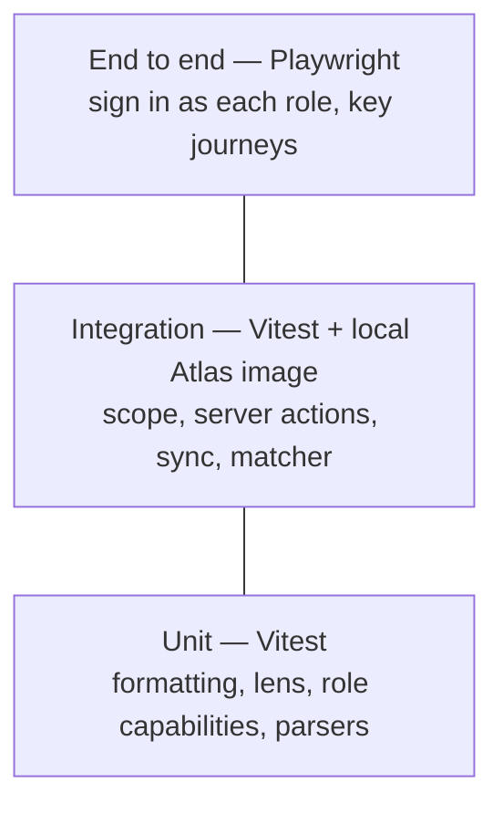

# Testing

**Status:** the test tooling (Vitest) is installed, but there are no automated
tests yet. Checks today are type-check, lint and manual browser verification.
This document is the plan to close that gap, starting with the riskiest code.

## Layers

| Layer | What it covers | Runs |
| --- | --- | --- |
| Unit | Pure functions: `format.ts`, `lens.ts`, role matrix, Zod schemas, prompt parsers | every push |
| Integration | Against a real MongoDB (`mongodb-atlas-local` in CI): `getRepScope` for every role, every server action's scope check and audit row, sync guardrails, matcher | every push |
| End to end | Playwright against a seeded app: dashboard per role, complete a task, palette search scope, dark mode | every PR |

## First tests to write

1. **Visibility matrix.** For each seeded user, `getRepScope` returns exactly the
   expected reps (own, reports, subtree, all, none).
2. **Scope leak guard.** A task outside the user's scope cannot be completed; no
   audit row is written.
3. **Write + audit atomicity.** If the audit insert fails, the task update rolls
   back.
4. **Palette scope.** A user's search never returns accounts outside scope.
5. **Seed guard.** Seeding a non-local URI without `--allow-remote` exits non-zero.

## Rules

- Tests that touch data use a throwaway database name per run and drop it after.
- Never point tests at a shared Atlas cluster.
- A bug fix comes with the test that would have caught it.
