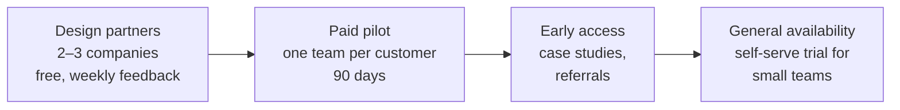

# Go to market

Everything here is a **hypothesis to test** with design partners, not a
decision.

## Stages

| Stage | Goal | Exit signal |
| --- | --- | --- |
| Design partners | Prove capture accuracy and daily use on real mailboxes | 95% of customer email filed; reps open Ambient daily without being asked |
| Paid pilot | Prove someone pays and managers change how they run reviews | Pilot converts to an annual contract |
| Early access | Repeatable sale with proof | Three referenceable customers with measured outcomes |
| General availability | Scale | Sales cycle and onboarding time predictable |

## Pricing hypotheses

| Plan | For | Shape (to test) |
| --- | --- | --- |
| Team | Up to 25 reps | Per user per month; capture, dashboard, tasks, Wren |
| Business | 25–500 reps | Per user per month; adds warehouse sync, manager suite, review queue, SSO |
| Enterprise | Large or regulated | Annual; dedicated database or region, custom connectors, support SLA |

AI cost grows with captured volume, so every plan includes a fair-use allowance
per user, and pricing is checked against `aiInvocations` cost data from pilots.

## Channels

1. **Founder-led sales** to sales leaders in the ideal-customer profile, starting
   with warm introductions.
2. **Microsoft 365 ecosystem:** listing the Outlook add-in in AppSource;
   partnering with Microsoft-focused IT consultancies that already serve these
   companies.
3. **Content:** short, concrete pieces on "the empty CRM problem", with numbers
   from design partners.

## What to measure

| Metric | Why |
| --- | --- |
| Capture rate (auto-filed / all customer email) | The core promise |
| Weekly active reps / licensed reps | Adoption |
| Tasks completed from AI suggestions | Whether "what to do next" works |
| Time to first value (sign-up to first filed email) | Onboarding friction |
| Gross margin per user after AI cost | Pricing health |
