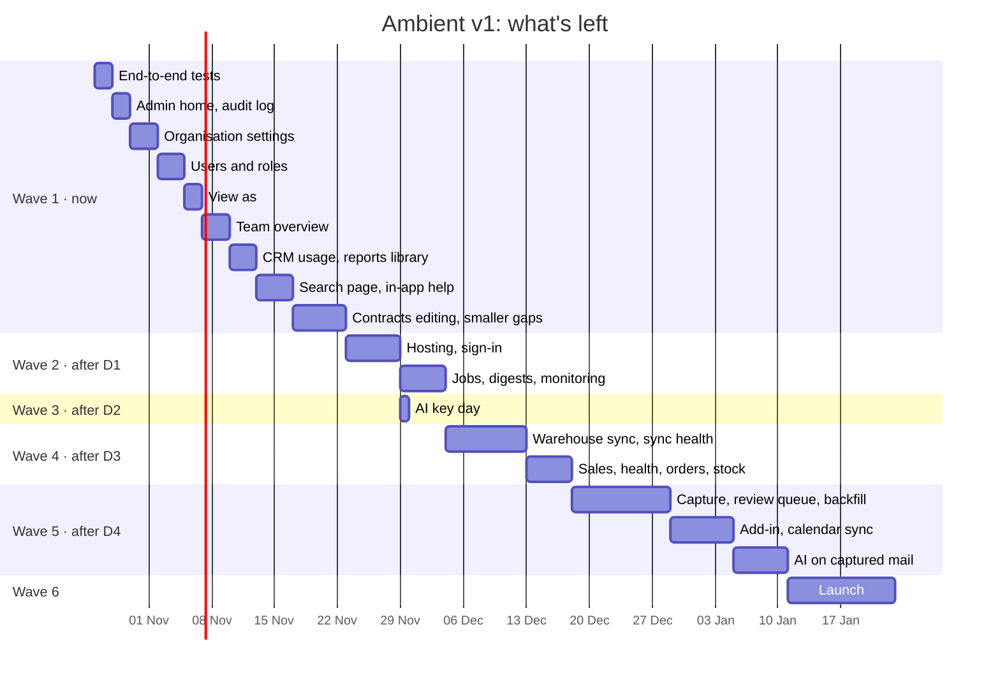

# Completion plan: everything left for Ambient v1

**Status:** Agreed, scope frozen · change 1 (the AI-first track) agreed 23 Oct 2026
**Written:** 22 Oct 2026 · **Agreed and frozen:** 22 Oct 2026

Every page and feature that isn't built yet, what each depends on, and the
order to build them in, so the whole of v1 is on one page.

**The scope is frozen.** The work packages, their order and the decisions
below are agreed. A package's own step plan may refine *how* it is built, but
adding, dropping, merging or reordering packages, or changing a decision, is
recorded in [Changes after the freeze](#changes-after-the-freeze) with the
date and the reason before the work changes. Each work package
below gets its own step plan in this folder when it starts, and is built the
same way as the AI steps: plan, build with tests, check in the browser, update
the docs, commit.

## Where we are

**Built:** the app shell and design system (light and dark), multi-tenancy,
role visibility and lenses, tenant settings (time zone, divisions, lenses), the
dashboard, accounts and the customer group page, the customer profile
(overview, tasks), contracts (read-only), contacts, tasks, the call cycle with
post-visit reports, notifications, CI, logging and versioned APIs, and the
whole AI layer (summary, morning brief, Wren chat and side panel, proposals,
follow-ups, evaluation and feedback, the admin AI report).

**Not built:** 13 pages are placeholders, four profile tabs wait for sales
data, and several features listed in [features](../product/features.md) are
marked Next or Planned. They fall into three kinds:

1. **Buildable now** on the data we already have (Wave 1).
2. **Blocked on an outside input:** a hosting and sign-in decision, the OpenAI
   key, a warehouse data source, or Microsoft 365 access (Waves 2 to 5).
3. **Launch work** once the product is complete (Wave 6).

## Everything left

| # | What | Where | Today | Depends on | Wave | Size |
| --- | --- | --- | --- | --- | --- | --- |
| 1.1 | Browser end-to-end tests | all pages | ✅ built ([plan](wave-1-1-end-to-end-tests.md)) | — | 1 | 2d |
| 1.2 | Admin home and audit log | `/admin`, `/admin/audit` | placeholders | — | 1 | 2d |
| 1.3 | Organisation settings (divisions, lenses, time zone, contact roles, AI policy, report links) | `/admin/settings` (new) | set in the seed | — | 1 | 3d |
| 1.4 | Users and roles | `/admin/users` (new) | seeded users only | — | 1 | 3d |
| 1.5 | View as | `/admin/view-as` | placeholder | 1.4 | 1 | 2d |
| 1.6 | Team overview | `/team` | placeholder | — | 1 | 3d |
| 1.7 | CRM usage | `/crm-usage` | placeholder | decision D8 | 1 | 2d |
| 1.8 | Reports library | `/reports` | placeholder | 1.3, decision D7 | 1 | 1d |
| 1.9 | Search page | `/search` | placeholder (Ctrl K exists) | — | 1 | 2d |
| 1.10 | In-app help | `/how-it-works/*` | placeholders | — | 1 | 2d |
| 1.11 | Contract editing, documents and renewal nudges | `/contracts`, profile | read-only | decision D5 | 1 | 4d |
| 1.12 | Smaller gaps: contact on a task, follow-up to task by hand, notification preferences | tasks, visits, notifications | not built | — | 1 | 2d |
| 2.1 | Hosting, environments and deployments | — | local only | decision D1 | 2 | 3d |
| 2.2 | Sign-in with Microsoft Entra ID | all | development sign-in | 1.4, 2.1 | 2 | 3d |
| 2.3 | Job runner and scheduled jobs (7am brief, renewal nudges) | — | on request only | 2.1 | 2 | 2d |
| 2.4 | Email notifications and digests | notifications | in-app only | 2.3, decision D6 | 2 | 2d |
| 2.5 | Monitoring, alerts and backups | — | logs only | 2.1 | 2 | 1d |
| 3.1 | AI key day: real-model evaluation, model choice, baseline | — | stand-in only | decision D2 | 3 | 1d |
| 4.1 | Warehouse and ERP sync with guardrails | mirror collections | seed data | 2.3, decision D3 | 4 | 8d |
| 4.2 | Sync health | `/admin/sync` | placeholder | 4.1 | 4 | 1d |
| 4.3 | Sales, health, open orders and stock figures | profile tabs, group page, dashboard | "comes with the sync" | 4.1 | 4 | 3d |
| 4.4 | Contacts written back to the warehouse | contacts | app only | 4.1, decision D3 | 4 | 2d |
| 5.1 | Email and meeting capture workers and matcher | timeline | not built | 2.2, 2.3, decision D4 | 5 | 8d |
| 5.2 | Review queue | `/review-queue` | placeholder | 5.1 | 5 | 2d |
| 5.3 | Email backfill for new or changed contacts | contacts | not built | 5.1 | 5 | 2d |
| 5.4 | Simulate arrival (development tool) | `/dev/simulate-arrival` | placeholder | 5.1 | 5 | 1d |
| 5.5 | Outlook add-in | Outlook task pane | not built | 2.2, 5.1 | 5 | 4d |
| 5.6 | Outlook calendar sync for visits | call cycle | not built | 2.2 | 5 | 3d |
| 5.7 | AI on captured mail: analysis, suggested tasks, semantic search | timeline, tasks, `/search` | not built | 5.1, 3.1 | 5 | 6d |
| 6.1 | Launch: security review, load and accessibility tests, pilot onboarding, go-live | — | — | everything above | 6 | 12d |

Sizes are working days for one developer with AI assistance, as planning
estimates. Wave 1 is about 28 days of work, the whole plan about 92.

## Wave 1: on the data we have (start now)

Nothing here waits on anyone. Recommended order: 1.1 first (it protects
everything after it), then the admin set (1.2 to 1.5), then the manager set
(1.6 to 1.8), then the rest.

**1.1 Browser end-to-end tests.** Playwright against the seeded app in CI:
sign in as each role, dashboard, accounts to profile, create and complete a
task, plan and report a visit, contacts and contracts, notifications, the
assistant and side panel (the "AI isn't set up yet" state), light and dark
mode, phone width. Would have caught the chat crash and layout breaks found
by hand in AI step 5. **Done when** CI runs them on every push.
**✅ Built 22 Oct 2026** ([plan](wave-1-1-end-to-end-tests.md)).

**1.2 Admin home and audit log.** The admin home links to every admin tool and
shows the tenant's state (AI on or off, users, last sync). The audit log lists
every write, newest first, filtered by person, record type, action and date,
with before and after values (text fields shown only as "changed", as they're
stored). Admins only, their tenant only.

**1.3 Organisation settings.** Edit the tenant's divisions, lenses, time zone
and contact roles; the AI policy (on or off, roles, features, monthly token
budget); and the report library's links (1.8). A division or role in use can
be deactivated, not deleted. Every change is audited.

**1.4 Users and roles.** List users with role, linked rep and status; create
(development) or invite (once sign-in exists, 2.2), change role, link to a rep,
deactivate. Shows the manager tree. Needed before real sign-in, which matches
provisioned users by their Microsoft object id.

**1.5 View as.** Super admins see the CRM as another user for a limited time
(for example 30 minutes) with a banner throughout; every write in that time is
audited with both people (the audit model already has the field). Off in
production unless explicitly turned on.

**1.6 Team overview.** For a manager's reporting tree, per rep: open and
overdue tasks, visits planned and completed, reports filed and average
scorecards, quiet accounts, and sales against target (from the snapshots in
the seed now, the warehouse later). Each row links to that rep's book.

**1.7 CRM usage.** Adoption per rep and team over 4 or 12 weeks, from the
records the CRM already keeps: interactions logged, visits completed with a
report, tasks completed on time, contacts kept up to date, AI use and
proposals accepted. Managers see their tree, admins every team. Logins and
page views aren't tracked today (decision D8).

**1.8 Reports library.** The tenant's BI reports (name, description, link,
which roles see it), managed in settings (1.3), opening in a new tab.

**1.9 Search page.** Full-page search across accounts, contacts, contracts
and tasks with filters, the same scope rules as everywhere, and the Ctrl K
palette's "see all results" link. Search by meaning over email comes with
capture (5.7).

**1.10 In-app help.** How it works (data flow, privacy, roles), How the AI
works (what Wren sees and never sees, the safety checks, feedback), and
Architecture (the diagrams), written for users from the engineering docs.

**1.11 Contract editing, documents and renewal nudges.** Create and edit
contracts in Ambient with document upload, and a renewal job: when a contract
enters the 30-day band, its owner gets a notification and a renewal task,
once. Runs on request now and on a schedule after 2.3. Contracts are a Mirror
today, so this needs decision D5 first (how app-edited contracts and the
warehouse's contracts live together, and where documents are stored).

**1.12 Smaller gaps.** A contact person on a task; turning a visit report's
follow-up into a task by hand (alongside Wren's suggestions); in-app
notification preferences (which kinds to get), used by digests later (2.4).

## Wave 2: sign-in and hosting (after decision D1)

**2.1 Hosting.** Production and staging on the chosen host (proposed: Vercel
and Atlas), preview deployments per pull request, secrets in the host's
settings, the health check, logs shipped to a hosted service.

**2.2 Sign-in with Entra ID.** Multi-tenant Microsoft sign-in (Auth.js);
users matched by object id to those provisioned in 1.4; development sign-in
removed from production builds; sign-out and session expiry.

**2.3 Job runner.** The chosen runner (or a secret-protected job route under
`/api/v1/jobs/`) with a way to run as a user without a browser session. Jobs:
the 7am morning brief, renewal nudges (1.11), cleanup.

**2.4 Email notifications and digests.** Through the chosen email provider
(decision D6), honouring the preferences from 1.12: a daily digest and
optional instant emails for assignments.

**2.5 Monitoring and backups.** Alerts on error rate, AI cost and failed jobs;
Atlas backups with a tested restore.

## Wave 3: AI key day (after decision D2, any time)

Set the OpenAI key, run `pnpm ai:eval` for each candidate model, pick the
cheapest that passes, save the baseline, and tune any prompt that fails a case
(with a version bump). Steps are in [operations](../technical/operations.md#ai-quality).

## Wave 4: the data spine (after decision D3)

**4.1 Warehouse and ERP sync.** Nightly jobs into the mirror collections
(reps, customer groups, accounts, contracts) and rollups (sales snapshots,
open orders, stock, health signals), with guardrails: a large drop in rows or
a schema change aborts the dataset instead of overwriting it. One `syncRuns`
row per dataset ([integrations](../architecture/integrations.md#warehouse-and-erp-sync)).

**4.2 Sync health.** Last run per dataset, row counts, failed and aborted runs.

**4.3 Sales, health, orders and stock.** The profile's Sales, Health, Open
orders and Stock tabs, the group page's period figures, and the dashboard on
real snapshots.

**4.4 Contacts write-back.** Contacts created or changed in Ambient sent to
the warehouse, if it accepts writes.

## Wave 5: passive capture and AI on mail (after Wave 2 and decision D4)

**5.1 Capture.** Workers read in-scope mailboxes and calendars through
Microsoft Graph; mail with no customer is never fetched; the matcher files
mail on the right account; Teams transcripts after meetings; personal data
redacted before any AI sees it ([integrations](../architecture/integrations.md#email-capture)).

**5.2 Review queue.** Mail the matcher couldn't file: approve (and teach the
matcher) or reject.

**5.3 Backfill.** Offer to pull past email when a contact is added or their
email changes.

**5.4 Simulate arrival.** A development tool that injects a test email into
the pipeline.

**5.5 Outlook add-in.** "Send to Ambient" on an email and "Add to Ambient" on
a meeting, creating contacts for unknown senders (`/api/v1/addin/*`).

**5.6 Calendar sync.** Planned visits to and from Outlook calendars.

**5.7 AI on captured mail.** Analysis of each email and meeting (asks,
commitments, sentiment) on the timeline; Wren's suggested tasks on the Tasks
page; embeddings and search by meaning on `/search`; Wren tools over analyses.
Evaluated with new cases before release.

## Wave 6: launch

Security review (tenant isolation, authorisation, OWASP, a penetration test),
load test, accessibility audit, pilot tenant onboarding (settings, users,
first sync), runbooks, and the go-live sign-off.

## AI-first track (change 1, agreed)

Wren becomes able to do everything a user can, by asking: every feature
becomes an action the forms and Wren share, then skills, connectors and
background work. Plan: [AI-first plan](ai-first-plan.md); design:
[AI-first design](../architecture/ai-first.md); decision:
[ADR 0008](../architecture/decisions/0008-ai-first.md). It adds seven phases
(about 84 days) and changes the order of what's left: key day (3.1) first,
then phases A and B before the rest of Wave 1, so every new page is built on
the action layer.

| Phase | What | Size |
| --- | --- | --- |
| A | The action layer: every read and write an action, idempotent and version-checked; Wren's tools generated from it; risk levels and bound confirms; Undo | 11d |
| B | Wren does the work: write tools through the policy, tool routing, the agent loop, ask back with buttons, evaluation | 15d |
| C | Chat-first: views in the chat, Wren home, memory and Wren settings | 10d |
| D | Skills: built-in and tenant skills | 10d |
| E | Connectors: the framework, Microsoft 365, the ERP on demand, BI, MCP servers | 20d |
| F | Background work: triggers, the Wren inbox, budgets | 10d |
| G | Trust and admin: AI actions in the audit log, AI policy controls, the release gate | 8d |

## Decisions and inputs needed from you

| # | Decision or input | Proposal | Blocks |
| --- | --- | --- | --- |
| D1 | Hosting and sign-in ([ADR 0005](../architecture/decisions/0005-hosting-and-sign-in.md)) | Vercel + Atlas + a managed job runner; Microsoft Entra ID | Wave 2, Wave 5, the 7am brief |
| D2 | The OpenAI key | The team's key | Wave 3 (real AI answers) |
| D3 | The warehouse or ERP: which system, how to read it, whether it accepts writes | — | Wave 4 |
| D4 | A Microsoft 365 test tenant and Graph consent for capture | Test mailboxes first | Wave 5 |
| D5 | Contracts edited in Ambient: alongside the ERP's (app-owned contracts marked as such) or replacing them; where documents live | App-owned contracts next to synced ones; documents in Atlas (GridFS) until hosting picks blob storage | 1.11 |
| D6 | Email provider for notifications and digests | The host's partner (for example Resend or SendGrid) | 2.4 |
| D7 | BI tool and which reports to link | Power BI, links managed per tenant | 1.8 |
| D8 | Whether CRM usage tracks logins and page views (needs a consent note) | Activity records only for now | 1.7 |
| D9 | How long Undo and confirms last | Undo for 24 hours while the record is unchanged; chat confirms expire after 24 hours, inbox proposals after 7 days | AI-first A.3, A.4 |
| D10 | Where people land | The dashboard with Wren's composer on top; each user can choose to land on Wren | AI-first C.2 |
| D11 | Sending email to customers through Wren | Only as a high action: one message, previewed, from your own mailbox, on an explicit Send; never in the background; a tenant can turn it off | AI-first E.2 |
| D12 | MCP servers in v1 | Yes, last, admin-approved only | AI-first E.5 |
| D13 | The agent loop's limits | 8 tool calls and 60 seconds by default; a tenant may raise them to 20 and 180 | AI-first B.3 |
| D14 | The strong model tier for plans and skills | Decided on key day from the evaluation set | AI-first B.3 |

D9 to D14 were agreed on 23 Oct 2026 as proposed, with change 1.

## Order and timeline

Change 1 (agreed 23 Oct 2026) reorders this: the order and timeline are now
the [AI-first plan's](ai-first-plan.md#timeline). The chart below is the order
before the change, kept for reference.

Dates assume each wave's decision arrives by the time the wave before it
ends; a later decision moves that wave and everything after it. With two
developers, Waves 1 and 2 (or 4 and 5) can run side by side.

## After v1

Unchanged from the [roadmap](../product/roadmap.md#after-v1): Google Workspace
capture, notification digests beyond the basics, configurable health scoring,
mobile visit capture, self-serve onboarding and billing. Nothing here is in
v1's scope.

## Changes after the freeze

| Date | Change | Reason |
| --- | --- | --- |
| 23 Oct 2026 | **Change 1, agreed:** the AI-first track (phases A to G, about 84 days) from the [AI-first plan](ai-first-plan.md); key day (3.1) moves first, after the docs are frozen; phases A and B come before Wave 1's 1.2 onwards; decisions D9 to D14 added; [ADR 0008](../architecture/decisions/0008-ai-first.md) changes the AI layer's guarantee 2 | Product direction: a person can do everything by asking Wren, without going page by page |
