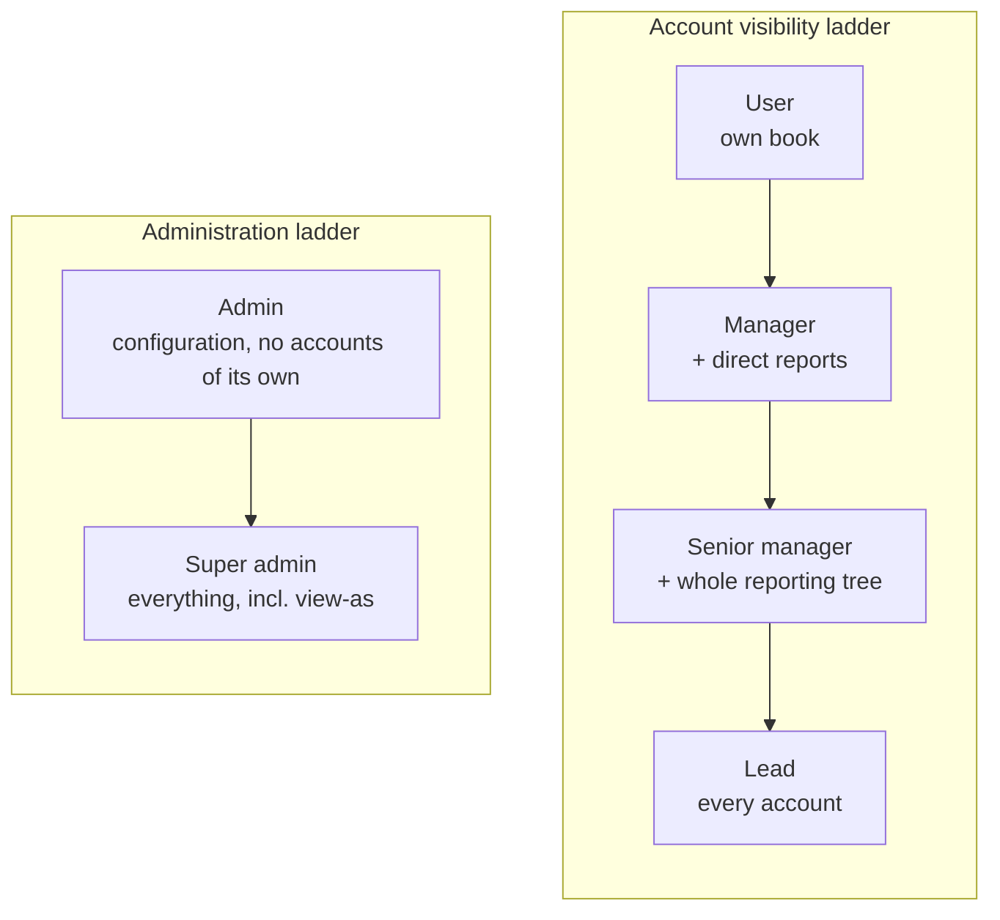

# Personas and roles

Ambient has six roles on two separate ladders: **account visibility** (which
customers you can see) and **administration** (what you can configure).

## Priya, account manager (role: User)

- Owns about 100 customer groups across two regions; on the road three days a week.
- Lives in Outlook and Teams; opens the CRM only when she must.
- **Needs:** a single "do this first" list, the full history of an account before
  a visit, and follow-ups that create themselves.
- **Frustrations:** retyping emails into a CRM, missing a renewal date, not knowing
  a colleague already spoke to the customer.
- **Ambient gives her:** the dashboard, account timeline, smart tasks, the morning
  brief and Cara.

## Liam, sales manager (role: Manager)

- Leads five reps. Runs weekly pipeline and account reviews.
- **Needs:** honest activity data without chasing people, early warning on at-risk
  accounts, and the ability to assign follow-ups.
- **Ambient gives him:** team overview, health and at-risk lists across his
  team's books, task assignment, CRM usage KPIs.

## Grace, head of sales (role: Senior manager)

- Owns a region of several teams. Reports to the leadership team monthly.
- **Needs:** a roll-up across every team below her, filtered by division.
- **Ambient gives her:** the division lens, subtree-wide dashboards and reports.

## Noah, CRM lead (role: Lead)

- Owns CRM adoption and data quality across the business.
- **Needs:** to see every account, fix mis-filed emails, and track usage.
- **Ambient gives him:** global visibility, the review queue and usage KPIs.

## Sam, administrator (role: Admin)

- IT or sales-ops. Configures integrations, users and settings.
- **Needs:** sync health, audit trail, user management. Does not need customer
  data to do the job, and does not get it by default.

## Alex, platform owner (role: Super admin)

- Owns the tenant. Can do everything an admin can, plus view-as for support,
  which is time-limited and audited.

## Role matrix

| Capability | User | Manager | Senior | Lead | Admin | Super |
| --- | :-: | :-: | :-: | :-: | :-: | :-: |
| See own accounts | ✓ | ✓ | ✓ | ✓ | – | ✓ |
| See direct reports' accounts | – | ✓ | ✓ | ✓ | – | ✓ |
| See whole reporting tree | – | – | ✓ | ✓ | – | ✓ |
| See every account | – | – | – | ✓ | – | ✓ |
| Division lens | – | – | ✓ | ✓ | – | ✓ |
| Assign tasks to others | – | ✓ | ✓ | ✓ | ✓ | ✓ |
| Review queue | – | – | – | ✓ | ✓ | ✓ |
| Manager pages (team, reports, usage) | – | ✓ | ✓ | ✓ | ✓ | ✓ |
| Admin pages (sync, audit) | – | – | – | – | ✓ | ✓ |
| View as another user | – | – | – | – | – | ✓ |
| Read captured email or meeting content | if participant | if participant | if participant | if participant | if participant | if participant |

The source of truth is [`apps/web/lib/auth/roles.ts`](../../apps/web/lib/auth/roles.ts).
