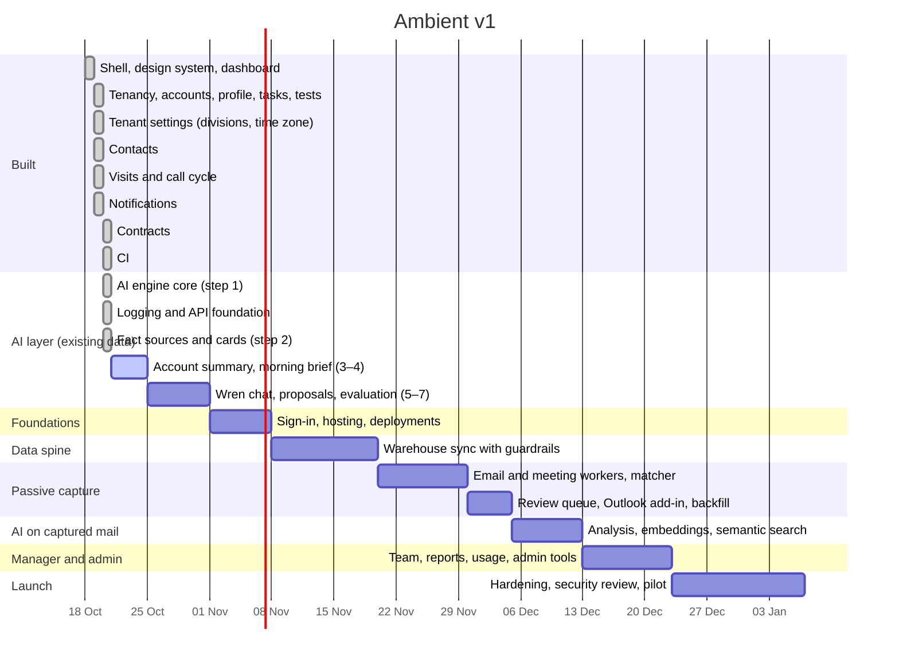

# Roadmap

Ambient is built in phases. Each phase ends at a gate that must pass before the
next phase depends on it. Dates are planning estimates for two developers
working with AI assistance, not commitments.

**This file is updated with every feature**, together with
[features.md](features.md) and the README progress table.

_Last updated: 20 Oct 2026 (AI step 2, fact sources and cards)._

## Where we are

The core CRM screens (Phase 2) are built on fictional demo data in Atlas, so
the product can be seen and tested end to end. Next is the **AI layer, built
step by step on the data we already have** (OpenAI, [ADR 0006](../architecture/decisions/0006-ai-provider.md)
accepted; see [AI layer](../architecture/ai.md)). Each step is built against a
test-only stand-in; the real model is tried once the team's OpenAI key arrives.
Real sign-in and hosting (Phase 0) wait on the hosting decision below, and the
warehouse sync (Phase 1) on a data source. The
data model and every query are already tenant-scoped and permission-checked,
so nothing built so far depends on demo-only shortcuts except development
sign-in.

| Status | Item | Phase |
| --- | --- | --- |
| ✅ Done | App shell, design system (navy and coral, light and dark), Ctrl K search | 0 |
| ✅ Done | Multi-tenancy: `tenantId` on every document, index and query ([ADR 0004](../architecture/decisions/0004-multi-tenancy.md)) | 0 |
| ✅ Done | Role visibility (own book, reports, reporting tree, all) and division lens | 1 |
| ✅ Done | Dashboard | 2 |
| ✅ Done | Accounts list with drill-down; customer profile; customer group page | 2 |
| ✅ Done | Tasks: today and all views, create, edit, assign, cancel | 2 |
| ✅ Done | Logged interactions (notes, calls, meetings) on the account timeline | 2 |
| ✅ Done | Automated tests: unit + integration on throwaway Atlas databases | – |
| ✅ Done | CI on every push and pull request: lint, typecheck, unit and integration tests (throwaway MongoDB), build | 0 |
| ✅ Done | Observability and API foundation: request ids, logging on every server action, API request and server error; `defineRoute` with `/api/health` and `/api/v1/me`; guard tests ([ADR 0007](../architecture/decisions/0007-api-versioning.md)) | 0 |
| ✅ Done | Tenant settings: each tenant's own divisions and lenses, and its time zone for "today", "overdue" and due dates | 1 |
| ✅ Done | Contacts: directory, add, edit, deactivate, profile card, Ctrl K search | 2 |
| ✅ Done | Call cycle: six weeks, week grid, plan, reschedule, cancel, post-visit report | 2 |
| ✅ Done | Notifications page: history by day, filters, mark read / all read | 2 |
| ✅ Done | Contracts: renewal bands, search, profile card (read-only) | 2 |
| Later | Sign-in (Entra ID), hosting, deployments ([ADR 0005](../architecture/decisions/0005-hosting-and-sign-in.md), proposed) | 0 |
| Later | Warehouse / ERP sync into the mirror collections | 1 |
| Later | Passive capture, review queue, Outlook add-in | 3 |
| ✅ Done | AI step 1, engine core: `defineAiFeature` / `runAiFeature`, OpenAI client and tiers, gates and tenant AI policy, usage log, token budgets, rate limits, test-only stand-in | 4 |
| ✅ Done | AI step 2: fact sources (account, my day) with handles, allowed fields, fencing and caps; cards for every record kind | 4 |
| ⏭ Next | AI step 3: account summary on the profile, with caching | 4 |
| Later | AI steps 4–7: morning brief, Wren read-only chat, proposals and follow-up suggestions, evaluation and feedback | 4 |
| Later | AI key day: configure the OpenAI key, run the evaluation set, tune prompts | 4 |
| Later | Email and meeting analysis, embeddings, semantic search (after capture) | 4 |
| Later | Team overview, reports, CRM usage, admin tools | 5 |
| Later | Hardening, security review, pilot | 6 |

## Timeline

## Phases and gates

| Phase | Scope | Gate to pass |
| --- | --- | --- |
| 0 Foundations | Shell and design system (**done**), multi-tenancy (**done**), CI (**done**), sign-in, hosting, deployments | A user signs in to their tenant in a deployed environment |
| 1 Data spine | Data model (**done** for current features), visibility rules (**done**), tenant settings (**done**), ERP/warehouse sync with guardrails | Each role sees exactly the right accounts on real-shaped data |
| 2 Core CRM | Dashboard, accounts, profile, group page, tasks, contacts, call cycle, notifications, contracts (**done**) | Product demo sign-off on every core page |
| 3 Passive capture | Email and meeting workers, matcher, review queue, backfill, Outlook add-in | Test mailboxes captured end to end with no manual step |
| 4 AI layer | Steps 1–7 on existing data (engine core, fact sources and cards, account summary, morning brief, Wren chat, proposals and follow-up suggestions, evaluation and feedback); then email and meeting analysis, embeddings and semantic search after capture | Evaluation set passes on the real model (key day); AI outputs reviewed on test mail; cost per user within budget |
| 5 Manager and admin | Team overview, reports, CRM usage, sync health, audit, view-as | Manager and admin acceptance testing |
| 6 Launch | Security review, load test, monitoring, pilot customer, onboarding | Go-live approval for the pilot tenant |

## Decisions waiting on you

| Decision | Needed before |
| --- | --- |
| Hosting and sign-in ([ADR 0005](../architecture/decisions/0005-hosting-and-sign-in.md)) | Phase 0 sign-in work |

## After v1

Ideas parked until v1 is live, roughly in priority order:

1. Google Workspace capture alongside Microsoft 365.
2. Notification preferences and digest emails.
3. Configurable health scoring per tenant.
4. Mobile-first visit capture (voice notes to post-visit reports).
5. Self-serve onboarding and billing.
