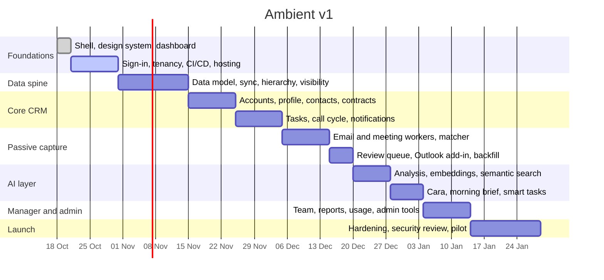

# Roadmap

Ambient is built in phases. Each phase ends at a gate that must pass before the
next phase depends on it. Dates are planning estimates for two developers
working with AI assistance, not commitments.

## Phases and gates

| Phase | Scope | Gate to pass |
| --- | --- | --- |
| 0 Foundations | Shell and design system (**built**), dashboard (**built**), sign-in, multi-tenancy, CI/CD, hosting | A user signs in to their tenant in a deployed environment |
| 1 Data spine | Full data model, ERP/warehouse sync with guardrails, manager hierarchy, visibility rules | Each role sees exactly the right accounts on real-shaped data |
| 2 Core CRM | Accounts, profile, contacts, contracts, tasks, call cycle, notifications | Product demo sign-off on every core page |
| 3 Passive capture | Email and meeting workers, matcher, review queue, backfill, Outlook add-in | Test mailboxes captured end to end with no manual step |
| 4 AI layer | Redaction, analysis, embeddings, semantic search, Cara, morning brief, smart tasks | AI outputs reviewed on real test mail; cost per user within budget |
| 5 Manager and admin | Team overview, reports, CRM usage, sync health, audit, view-as | Manager and admin acceptance testing |
| 6 Launch | Security review, load test, monitoring, pilot customer, onboarding | Go-live approval for the pilot tenant |

## After v1

Ideas parked until v1 is live, roughly in priority order:

1. Google Workspace capture alongside Microsoft 365.
2. Notification preferences and digest emails.
3. Configurable health scoring per tenant.
4. Mobile-first visit capture (voice notes to post-visit reports).
5. Self-serve onboarding and billing.
