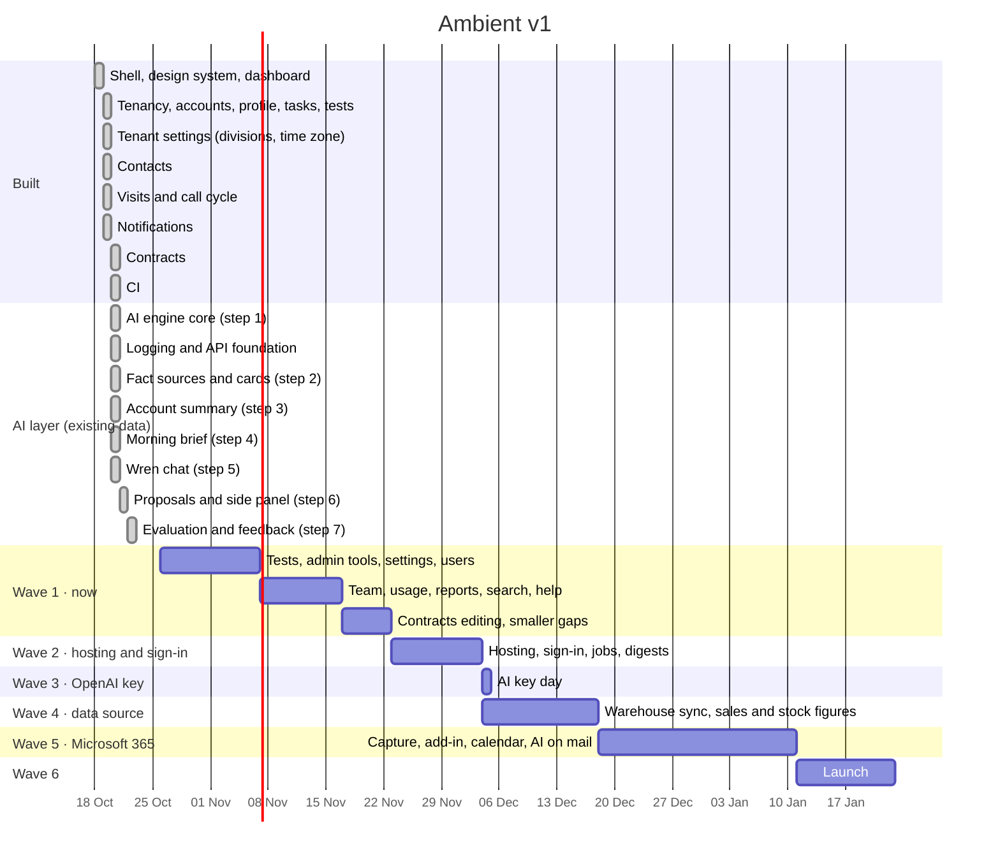

# Roadmap

Ambient is built in phases. Each phase ends at a gate that must pass before the
next phase depends on it. Dates are planning estimates for two developers
working with AI assistance, not commitments.

**This file is updated with every feature**, together with
[features.md](features.md) and the README progress table.

_Last updated: 22 Oct 2026 (completion plan agreed; v1 scope frozen)._

## Where we are

The core CRM screens (Phase 2) and the whole AI layer (Phase 4, steps 1 to 7)
are built on fictional demo data in Atlas. **What's left is in the
[completion plan](../plans/completion-plan.md)**: every unbuilt page and
feature, grouped into waves by what it depends on. It is agreed and the v1
scope is frozen: changes are recorded in the plan before the work changes.
Wave 1 (admin, manager and
help pages, search, contract editing, end-to-end tests) can start now; the
other waves wait on the decisions below (hosting and sign-in, the OpenAI key,
a warehouse data source, Microsoft 365 access). The data model and every
query are already tenant-scoped and permission-checked, so nothing built so
far depends on demo-only shortcuts except development sign-in.

| Status | Item | Phase |
| --- | --- | --- |
| ✅ Done | App shell, design system (navy and coral, light and dark), Ctrl K search | 0 |
| ✅ Done | Multi-tenancy: `tenantId` on every document, index and query ([ADR 0004](../architecture/decisions/0004-multi-tenancy.md)) | 0 |
| ✅ Done | Role visibility (own book, reports, reporting tree, all) and division lens | 1 |
| ✅ Done | Dashboard | 2 |
| ✅ Done | Accounts list with drill-down; customer profile; customer group page | 2 |
| ✅ Done | Tasks: today and all views, create, edit, assign, cancel | 2 |
| ✅ Done | Logged interactions (notes, calls, meetings) on the account timeline | 2 |
| ✅ Done | Automated tests: unit + integration on throwaway Atlas databases | – |
| ✅ Done | CI on every push and pull request: lint, typecheck, unit and integration tests (throwaway MongoDB), build | 0 |
| ✅ Done | Observability and API foundation: request ids, logging on every server action, API request and server error; `defineRoute` with `/api/health` and `/api/v1/me`; guard tests ([ADR 0007](../architecture/decisions/0007-api-versioning.md)) | 0 |
| ✅ Done | Tenant settings: each tenant's own divisions and lenses, and its time zone for "today", "overdue" and due dates | 1 |
| ✅ Done | Contacts: directory, add, edit, deactivate, profile card, Ctrl K search | 2 |
| ✅ Done | Call cycle: six weeks, week grid, plan, reschedule, cancel, post-visit report | 2 |
| ✅ Done | Notifications page: history by day, filters, mark read / all read | 2 |
| ✅ Done | Contracts: renewal bands, search, profile card (read-only) | 2 |
| ✅ Done | AI step 1, engine core: `defineAiFeature` / `runAiFeature`, OpenAI client and tiers, gates and tenant AI policy, usage log, token budgets, rate limits, test-only stand-in | 4 |
| ✅ Done | AI step 2: fact sources (account, my day) with handles, allowed fields, fencing and caps; cards for every record kind | 4 |
| ✅ Done | AI step 3: account summary on the profile, cached per user until the records change, gaps worked out by code | 4 |
| ✅ Done | AI step 4: morning brief on request, kept for the day with its cards; headline counted by code; dashboard tile | 4 |
| ✅ Done | AI step 5: Wren chat, read-only: five tools as the user, verified answers with cards, saved conversations, streaming progress | 4 |
| ✅ Done | AI step 6: proposals (tasks, visits, notes) accepted through the forms' code, follow-up suggestions from visit reports, the Wren side panel | 4 |
| ✅ Done | AI step 7: evaluation harness with fixed checks and a baseline gate, 👍 / 👎 feedback, the admin AI usage report | 4 |
| ⏭ Next | **Wave 1** (now): end-to-end tests; admin home, audit log, organisation settings, users and roles, view as; team overview, CRM usage, reports library; search page; in-app help; contract editing and renewal nudges; smaller gaps ([completion plan](../plans/completion-plan.md#wave-1-on-the-data-we-have-start-now)) | 1, 5 |
| Waiting on D1 | **Wave 2**: hosting and deployments, Entra ID sign-in, job runner (7am brief, renewal nudges), email digests, monitoring ([ADR 0005](../architecture/decisions/0005-hosting-and-sign-in.md), proposed) | 0 |
| Waiting on D2 | **Wave 3**: AI key day: set the OpenAI key, run `pnpm ai:eval`, pick the model, save the baseline | 4 |
| Waiting on D3 | **Wave 4**: warehouse and ERP sync with guardrails, sync health, sales, health, open orders and stock figures, contacts write-back | 1 |
| Waiting on D4 | **Wave 5**: email and meeting capture, review queue, backfill, Outlook add-in, calendar sync, AI on captured mail and search by meaning | 3, 4 |
| Later | **Wave 6**: security review, load and accessibility tests, pilot onboarding, go-live | 6 |

## Timeline

## Phases and gates

| Phase | Scope | Gate to pass |
| --- | --- | --- |
| 0 Foundations | Shell and design system (**done**), multi-tenancy (**done**), CI (**done**), sign-in, hosting, deployments | A user signs in to their tenant in a deployed environment |
| 1 Data spine | Data model (**done** for current features), visibility rules (**done**), tenant settings (**done**), ERP/warehouse sync with guardrails | Each role sees exactly the right accounts on real-shaped data |
| 2 Core CRM | Dashboard, accounts, profile, group page, tasks, contacts, call cycle, notifications, contracts (**done**) | Product demo sign-off on every core page |
| 3 Passive capture | Email and meeting workers, matcher, review queue, backfill, Outlook add-in | Test mailboxes captured end to end with no manual step |
| 4 AI layer | Steps 1–7 on existing data (engine core, fact sources and cards, account summary, morning brief, Wren chat, proposals and follow-up suggestions, evaluation and feedback); then email and meeting analysis, embeddings and semantic search after capture | Evaluation set passes on the real model (key day); AI outputs reviewed on test mail; cost per user within budget |
| 5 Manager and admin | Team overview, reports, CRM usage, sync health, audit, view-as | Manager and admin acceptance testing |
| 6 Launch | Security review, load test, monitoring, pilot customer, onboarding | Go-live approval for the pilot tenant |

## Decisions waiting on you

Details and proposals are in the [completion plan](../plans/completion-plan.md#decisions-and-inputs-needed-from-you).

| # | Decision or input | Blocks |
| --- | --- | --- |
| D1 | Hosting and sign-in ([ADR 0005](../architecture/decisions/0005-hosting-and-sign-in.md)) | Wave 2, Wave 5, the 7am brief |
| D2 | The OpenAI key | Wave 3 |
| D3 | The warehouse or ERP data source | Wave 4 |
| D4 | A Microsoft 365 test tenant and Graph consent | Wave 5 |
| D5 | How app-edited contracts live with the ERP's, and where documents are stored | Contract editing (Wave 1) |
| D6 | Email provider | Email digests (Wave 2) |
| D7 | BI tool and report links | Reports library (Wave 1) |
| D8 | Whether CRM usage tracks logins and page views | CRM usage (Wave 1) |

## After v1

Ideas parked until v1 is live, roughly in priority order:

1. Google Workspace capture alongside Microsoft 365.
2. Notification preferences and digest emails.
3. Configurable health scoring per tenant.
4. Mobile-first visit capture (voice notes to post-visit reports).
5. Self-serve onboarding and billing.
