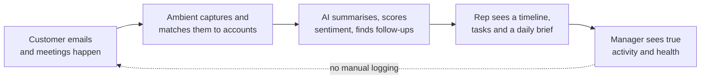

# Product vision

## The problem

B2B account managers look after a book of a few hundred customer accounts.
Almost everything that matters about those relationships already happens in
email and meetings, but CRMs only know what someone typed in. Reps don't log
activity, so the CRM goes stale, managers stop trusting it, and the business
runs on spreadsheets and memory.

The failure is not discipline. It is asking busy people to do data entry for a
system that gives them little back.

## The idea

**A CRM that fills itself in.** Ambient reads the customer conversations reps
already have, files them on the right account automatically, and turns them
into what to do next.

## Principles

1. **Passive capture first.** If a rep has to type it, assume it won't happen.
   Email and meetings are captured in the background; manual entry is the
   fallback, not the default.
2. **Privacy by participant.** Captured content is readable only by the internal
   people who were on that email or meeting. Seniority widens which *accounts*
   you can see, never whose *words* you can read. No admin override.
3. **AI on stored facts.** Raw text reaches the model only in the analysis
   pipeline, after redaction. Every interactive feature works from stored
   summaries, so answers are fast, cheap and traceable.
4. **Action over reporting.** Every screen answers "what should I do next?"
   before "what happened?".
5. **The warehouse owns history, Ambient owns activity.** Sales, orders and
   account records come from the customer's systems of record. Ambient owns what
   people do: tasks, visits, notes, contacts and captured conversations.
6. **Ask, don't click.** Anything a person can do in Ambient, they can ask
   Wren to do, with the same rights and the same rules. Small changes to your
   own work happen at once and can be undone; anything else waits for your
   yes. Pages remain for browsing, not as the only way in
   ([AI-first design](../architecture/ai-first.md)).

## What success looks like

| Measure | Target |
| --- | --- |
| Share of customer emails filed without a rep touching them | 95% or more |
| Weekly active reps | 80% or more of licensed reps |
| Time to see "what to do today" after sign-in | under 2 seconds |
| Manual activity logging per rep per week | under 10 minutes |
| Managers who use Ambient as the source for pipeline reviews | all of them |

## What Ambient is not

- Not a marketing automation or email-sequencing tool.
- Not a replacement for the ERP or data warehouse; it reads from them.
- Not a surveillance tool: managers see activity and health, not private content.
