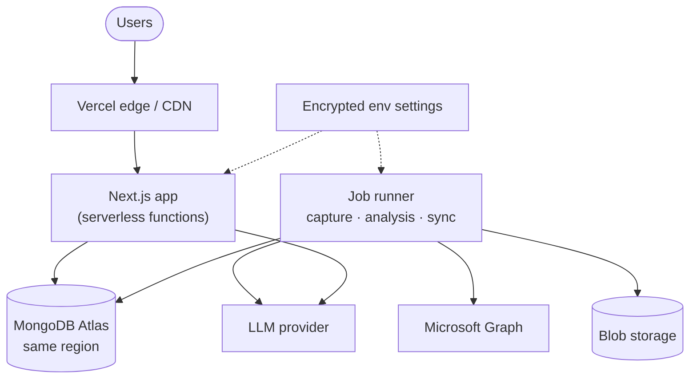
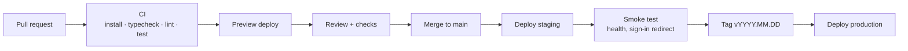

# Deployment

**Status: planned.** Nothing is deployed yet; the app runs locally against
MongoDB Atlas. Hosting follows [ADR 0005](../architecture/decisions/0005-hosting-and-sign-in.md)
once it is accepted.

## Environments

| Environment | Purpose | Database | Data | Sign-in |
| --- | --- | --- | --- | --- |
| Local | Development | Atlas cluster0 (`ambient_crm`) or local Docker | Fictional seed | Development role switcher |
| Preview | One per pull request | Shared preview database | Fictional seed | Entra (test tenant) |
| Staging | Release candidate, demos | Staging cluster | Fictional seed + test mailboxes | Entra (test tenant) |
| Production | Customers | Production cluster per region | Customer data | Entra (customer tenants) |

## Target topology

## Pipeline (planned)

## Release checklist

- [ ] CI green on the commit being released
- [ ] Database indexes applied (`pnpm db:indexes`) before code that needs them
- [ ] New environment variables set in every environment
- [ ] Development sign-in disabled (`AMBIENT_DEV_AUTH` unset; production ignores it anyway)
- [ ] Smoke test: signed-out request redirects to sign-in; dashboard loads for a test user
